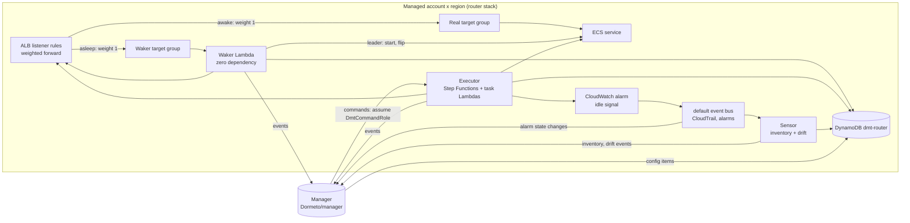
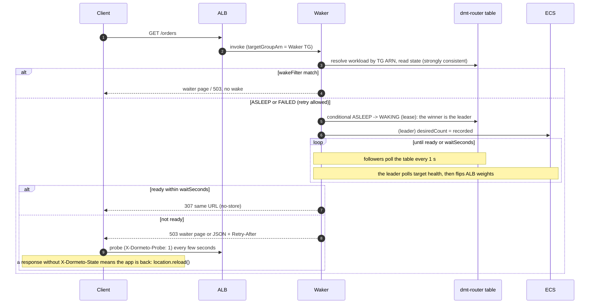

# Dormeto Router — Implementation Plan

> Status: draft v0.3 — 2026-09-27 (split from the Kloudy Awaker plan v0.2)
> Repository: `Dormeto/router` — the **data plane**. Companion repository: `Dormeto/manager` — the **management plane**
> (see its `docs/PLAN.md`).
> Scope: AWS first (ALB + ECS), then ALB + EC2/ASG, then RDS. GCP, Azure and S3NS adapters later.
> Stack: TypeScript on the **Node.js Lambda runtime** (`nodejs24.x`, arm64), **CloudFormation templates** deployed
> through StackSets by the manager's Terraform, fully serverless, **no VPC**.
> Naming: product **Dormeto**, resource prefix `dmt`, tag prefix `dormeto`, metric namespace `Dormeto`.

---

## 1. Purpose

Dormeto puts idle web workloads to sleep and wakes them just-in-time on the next request.

The **router** is everything that runs **inside the managed accounts and regions**:

- the **Waker**, the ALB Lambda target that answers requests while a workload sleeps, wakes it, holds or
  redirects the request, or serves the waiter page;
- the **Executor**, which performs onboarding, sleep, wake, restore and remediation on ALB rules and backends;
- the **Sensor**, which discovers resources, watches configuration changes (drift) and reports to the manager;
- the **contracts** shared with the manager (commands, events, table items, configuration schemas);
- the break-glass CLI.

The router holds **all cloud-specific code** (AWS today; GCP, Azure and S3NS later). The manager stays mostly
cloud-agnostic: it decides, the router executes.

### Design principles

1. **Waking never depends on the manager.** Waker, Executor, runtime state and baseline all live in the
   workload's account and region.
2. **Manager = brain, router = hands.** The manager sends commands (onboard, sleep, restore, remediate, config). The router
   executes and reports events. Cross-account permissions granted to the manager stay minimal.
3. **Runtime state is authoritative in the router** (`AWAKE`, `SLEEPING`, `ASLEEP`, `WAKING`, `FAILED`). Desired
   configuration is authoritative in the manager and pushed to the router.
4. **Every mutation is reversible:** baseline snapshot before the first change, a break-glass restore without the manager.
5. **Zero bundled dependencies on the request path** (Waker).

---

## 2. Glossary

| Term | Definition |
|---|---|
| **Workload** | Unit that sleeps and wakes together: route bindings + backends + policy. |
| **Route binding** | ALB listener rule (or listener default action) forwarding to a workload target group. |
| **Backend** | Resource stopped and started: ECS service (P1), EC2 instance and ASG (P4), RDS/Aurora (P5). |
| **Companion backend** | Backend without a route binding that wakes with the workload (internal service, database). |
| **Waker target group** | `lambda` target group, one per (workload, ALB): weight 0 when awake, 1 when asleep. |
| **Baseline** | Snapshot of the original customer configuration, used for restore and drift. |
| **Router stack** | CloudFormation stack deployed per account × region (`dmt-router`). |

---

## 3. Architecture



### 3.1 Router stack content (per account × region)

| Resource | Purpose |
|---|---|
| `dmt-waker` Lambda + `live` alias | Request path (§5) |
| `dmt-executor` Step Functions state machines + task Lambdas | `Apply`, `Sleep`, `Wake`, `Restore`, `Remediate`, `Rebaseline` (§6) |
| `dmt-sensor` Lambdas | Inventory scan, drift checks (§8) |
| `dmt-router` DynamoDB table | Workload descriptors, runtime state, leases, baseline, page templates (§9) |
| EventBridge rules (default bus) | CloudTrail management events for ELBv2/ECS/App Auto Scaling/CloudWatch/Lambda → Sensor; alarm state changes, router events → manager bus |
| Log groups | Retention from stack parameter (default 30 days) |
| IAM roles | `DmtWakerRole`, `DmtExecutorRole`, `DmtSensorRole` (§10) |

Account-level stack (once per account, global resources): `dmt-router-account` with `DmtCommandRole` (trusted by the
manager) and `DmtMetricsReadRole` (dashboard charts).

### 3.2 Repository layout

```
router/
├── packages/
│   ├── contracts/        # @dormeto/contracts: JSON Schemas + TS types (commands, events, table items, config)
│   ├── core/             # cloud-agnostic router logic: runtime state machine, leases, flip planning, drift diff
│   ├── page/             # waiter page renderer + default page + reload script (no dependency)
│   ├── waker/            # Waker handler, single-file ESM build, zero dependency
│   ├── executor/         # Executor task handlers + ASL definitions
│   ├── sensor/           # inventory + drift handlers
│   ├── aws/              # AWS adapters: RouterPort (ALB), BackendPort (ECS; later EC2, ASG, RDS), IdleSignalPort
│   └── cli/              # dormeto-router CLI: status, restore (break-glass)
├── templates/
│   ├── router-region.yaml    # per account x region stack
│   └── router-account.yaml   # per account stack (roles)
├── buildspec/            # CodeBuild: build.yml, publish.yml
├── test/                 # integration + load test scenarios, sample workload fixture (ECS behind ALB)
└── docs/
```

npm workspaces, TypeScript strict mode, `tsc` type-check and esbuild bundles. Formatting and lint are shared with the manager.

---

## 4. Routing (ALB)

### 4.1 Weighted forward

- **Apply (onboarding)**:
  1. snapshot the baseline (full rule actions, conditions, priority, listener default action, target group attributes);
  2. create the Waker target group `dmt-<hash>` (type `lambda`, one per workload × ALB, because the Waker identifies the
     workload from `requestContext.elb.targetGroupArn`), register the Waker `live` alias;
  3. rewrite each bound forward action as `ForwardConfig { realTG(s): original weights, wakerTG: 0 }`. All other
     actions are preserved **unchanged and in order**: `authenticate-cognito`/`authenticate-oidc` stay in front, so only
     authenticated requests can wake the workload. Stickiness is preserved;
  4. tag the rule `dormeto:managed=<workloadId>` (ownership marker, also used in IAM conditions).
- **Sleep flip:** every real TG weight → 0, Waker TG → 1. **Wake flip:** original weights, Waker TG → 0. At weight 0 the
  ALB never invokes the Waker, so it is not in the data path while awake.
- **Restore (offboarding):** wake if asleep, restore baseline actions exactly (single-TG form if that was the original),
  delete the Waker TG, remove tags and alarm, resume autoscaling.
- Before every write, re-read the rule and compare it with the expected state. On mismatch: **no write**, `DriftDetected`.

### 4.2 Eligibility (reported with the inventory)

| Check | Reason code |
|---|---|
| Service has at least one ALB target group (or is a declared companion) | `no-route` |
| Forward action has ≤ 4 target groups (a 5th slot is needed for the Waker TG) | `too-many-target-groups` |
| ECS deployment controller is `ECS` (rolling). CodeDeploy, `EXTERNAL` and native ECS blue/green rewrite listener rules | `deployment-controller-conflict` |
| No deployment in progress at apply time | `deployment-in-progress` (retry) |
| HTTP/HTTPS listener, not gRPC protocol version | `unsupported-protocol` |
| Target group quotas available | `quota` |
| No `dormeto=disabled` tag on the ALB or rule | `route-excluded` |

Warnings (still eligible): WebSocket upgrades seen, slow health checks, EC2 capacity provider with managed scaling,
CloudFront in front with an origin read timeout shorter than `waitSeconds`.

### 4.3 Limits to respect

- The Lambda and its target group must be in the same account and region, hence one router stack per account × region.
- ALB → Lambda: 1 MB request and response, no WebSockets (upgrade → 400), **no response streaming**.
- Health checks are the main wake-latency factor. The latency advisor recommends 5 s interval and healthy threshold 2.

---

## 5. Waker (request path)

### 5.1 Options (per workload, pushed by the manager)

| Option | Default | Description |
|---|---|---|
| `waitSeconds` | `20` | Maximum hold before the waiter page. **`0` = never hold**: wake is triggered and the page is returned immediately. |
| `readyResponse` | `redirect` | Ready within `waitSeconds`: `307` to the same URL (method and body preserved). A later `proxy` mode could only target internet-facing ALBs through their public endpoint (no VPC). |
| `page.template` | `default` | Built-in page or custom template ID. |
| `page.statusCode` | `503` | `503` + `Retry-After`, or `200` if a CDN/WAF rewrites 503s. |
| `page.pollIntervalSeconds` | `3` (jitter, backoff up to 15) | Reload probe interval. |
| `api.format` | `json` | Non-HTML clients get `503` + `Retry-After` + `{ "status": "waking", "retryAfter": 10 }`. |
| `maxHolders` | `50` | Concurrently held requests per workload. Beyond that, the page is returned immediately. |
| `wakeFilter` | health paths, known bots, `HEAD` | Requests answered without triggering a wake. |
| `wakeTimeoutSeconds` | `600` | Wake marked `FAILED` after this. |
| `maxWakesPerHour` | `12` | Wake-storm protection. Beyond it: "temporarily unavailable" page + alert. |

`waitSeconds` must be ≤ Waker timeout − 5 s. The Waker timeout is a stack parameter (max 900 s).

### 5.2 Flow



### 5.3 Waiter page

- **Built-in page:** light, accessible, dark/light, minimal i18n (en, fr) from `Accept-Language`, progress based on the
  measured p50 wake time, `<noscript>` meta-refresh fallback.
- **Reload mechanism:** `fetch(location.href, { cache: 'no-store', headers: { 'X-Dormeto-Probe': '1' } })`. While asleep
  the Waker answers probes in milliseconds with `X-Dormeto-State: waking|failed`. After the flip, the real app answers
  without that header and the page reloads. There is no extra ALB rule and no status endpoint in the customer path.
- **Custom page:** HTML template (≤ 256 KB) pushed by the manager into the table.
  - Variables (HTML-escaped): `{{workload.name}}`, `{{state}}`, `{{elapsedSeconds}}`, `{{estimatedSeconds}}`,
    `{{retryAfter}}`, `{{requestId}}`, `{{dormeto.script}}`.
  - The reload script is injected before `</body>` when the placeholder is missing.
  - Assets must be inline or absolute URLs.
- All Waker responses: `Cache-Control: no-store`.

### 5.4 Implementation constraints

- **Zero bundled dependencies:** one ESM file (`index.mjs`), no `node_modules`, no layer. Only Node.js built-ins and the
  **AWS SDK v3 clients provided by the `nodejs24.x` runtime** (`client-dynamodb`, `client-ecs`,
  `client-elastic-load-balancing-v2`, `client-application-auto-scaling`; later `client-ec2`, `client-auto-scaling`,
  `client-rds`).
  - CI fails if the bundle contains third-party code or if `packages/waker/package.json` declares runtime dependencies.
- SDK clients at module scope, adaptive retry, short timeouts.
- The page renderer is plain template substitution. The default page and script are inlined as string constants at build time.
- Budgets: bundle < 100 KB, init < 150 ms, probe p99 < 50 ms warm.
- Configuration through environment variables only (`DMT_TABLE`, `DMT_MANAGER_BUS_ARN`, `DMT_LOG_LEVEL`). Workload data
  always comes from the local table, never from the manager.
- No VPC, 256 MB, arm64, reserved concurrency (stack parameter, default 100).
- Fallback (decision R3): in-house SigV4 signer (`node:crypto` + `fetch`) if the runtime SDK version becomes an issue.

---

## 6. Executor (sleep, wake, apply, restore)

Step Functions Standard state machines. Each task Lambda is idempotent and every write goes through a conditional
state transition.

### 6.1 Sleep (ECS), abortable until step 5

1. `AWAKE → SLEEPING` (conditional on `version`).
2. Flip routes to the Waker TG, verified with `DescribeRules`.
3. Drain wait: `min(deregistration_delay, drainCap)` (default cap 30 s).
4. Record `desiredCount` and the scalable target (min, max, suspended state). Suspend dynamic and scheduled scaling
   and lower min capacity to 0. Spike S2 confirms whether lowering min capacity is required.
5. `UpdateService desiredCount=0` for every service of the workload.
6. `SLEEPING → ASLEEP`, or `→ WAKING` when `pendingWake` is set.

### 6.2 Wake (Waker leader, or Executor for manual/scheduled wakes)

1. `ASLEEP → WAKING` with lease (§7.1).
2. Restore `desiredCount` (option `wakeDesiredCount` to start smaller), restore the scalable target and resume scaling.
   Companions first when a dependency order is declared (generalized in P5).
3. Readiness: each real TG has ≥ `minHealthyTargets` (default 1) healthy targets. Only the leader polls.
4. Wake flip, verified.
5. `WAKING → AWAKE`, `WakeCompleted` event with its duration.

- **Failure** (crash loop, image pull, capacity): after `wakeTimeoutSeconds` → `FAILED`. The route stays on the Waker (error
  page), an alert event is emitted, and the next request retries with backoff. After `maxConsecutiveWakeFailures` (3): circuit
  open, auto-wake disabled.
- **External wake** (`desiredCount > 0` observed while asleep, e.g. a CI deployment): the Sensor starts a wake that
  waits for readiness and flips back. The Waker also self-heals when backends are already healthy.

### 6.3 Apply, restore, remediate, rebaseline

- `Apply`: eligibility re-check, baseline snapshot (stored locally, copy sent to the manager), Waker TG, weighted forward,
  ownership tags, idle alarm.
- `Restore`: exact baseline restore (golden-file tested), cleanup.
- `Remediate`: `reapply` (expected state) or `adopt` (actual → new baseline).
- `Rebaseline`: refresh the baseline while awake after legitimate customer changes (new TG, new rule).

### 6.4 Idle signal provisioning

- One CloudWatch alarm per workload: metric math `FILL(m1,0) + FILL(m2,0) + ...` over `AWS/ApplicationELB RequestCount`
  (`LoadBalancer` + `TargetGroup` of each **real** TG). Condition `<= threshold` for `idleMinutes` 1-minute datapoints,
  `TreatMissingData=breaching`.
- Custom metric: namespace, metric, dimensions, statistic, threshold, or a full metric-math expression. It is validated with a
  dry-run `GetMetricData` before creating the alarm.
- Alarm state changes are forwarded to the manager, which applies its policies (minimum awake time, schedules, pause)
  and sends the `Sleep` command.

---

## 7. Concurrency management

### 7.1 Wake single-flight (leader election)

- Runtime item: `state`, `version`, `wakeId`, `leaseOwner`, `leaseUntil`, `wakeStartedAt`, `pendingWake`, `holders`.
- The first invocation performs the conditional update `state IN (ASLEEP, FAILED*) → WAKING` with `leaseUntil = now +
  60 s`, renewed every 15 s. Only the leader calls ECS/ELB APIs.
- Followers never call AWS APIs: they poll the item (strongly consistent `GetItem`, 1 s + jitter). This protects the
  account-wide `DescribeTargetHealth`/`DescribeServices` quotas.
- If the leader crashes or times out, the lease expires and the next invocation takes over (condition `leaseUntil < now`). Every
  step is idempotent (absolute `desiredCount`, absolute weights).
- The Executor uses the same lease protocol.

### 7.2 Held-request limits

- `holders`: atomic `ADD +1` on entry and `ADD -1` in `finally`. When `holders ≥ maxHolders`, the page is returned immediately. The counter is reset
  when the state leaves `WAKING`, so crashes can't leak it.
- Waker reserved concurrency protects the account Lambda pool. The router stack checks the account concurrency quota and
  emits a warning event when it is low (some new accounts have very low quotas).
- Probes never hold. A per-execution 1 s in-memory cache of the state item absorbs probe bursts.

### 7.3 Sleep versus wake races

- Sleep steps re-read the state at each checkpoint. A Waker invocation during `SLEEPING` sets `pendingWake=true`.
- Before step 5 (backends still running): a pending wake **aborts** the sleep (flip back, `AWAKE`, instant).
- After step 5: the final transition is `SLEEPING → WAKING` and the wake starts right away.
- Duplicate `Sleep` commands are ignored: the execution name is `sleep-<workloadId>-<stateVersion>`.

### 7.4 Flip consistency and redirect-loop guard

- Several rules or ALBs per workload: flip rule by rule with retries and backoff, verify with `DescribeRules`, set `AWAKE`
  only when every rule is verified.
- A request reaching the Waker while the state is `AWAKE` means a rule is still diverted. The Waker re-applies the flip under the lease,
  waits briefly, then returns `307`. A short-lived cookie `dmt_r` counts redirects: after 2, the page is served instead
  and `RouteFlipInconsistent` is emitted.

---

## 8. Sensor (inventory and drift)

### 8.1 Inventory

- In its account and region: ALBs, listeners, rules, target groups, ECS clusters and services (later EC2, ASG, RDS), with
  tags.
- Builds the graph `rule → target groups → service` and the candidate workloads (connected components, plus the
  `dormeto:workload` tag for companions). Each candidate carries eligibility reasons (§4.2).
- Triggers: schedule (15 min) + local CloudTrail events on the default bus (`CreateService`, `UpdateService`,
  `DeleteService`, `CreateRule`, `ModifyRule`, `DeleteRule`, `ModifyListener`, `AddTags`, `RemoveTags`, ...).
- Reports **deltas** to the manager bus (one event per resource or candidate workload, well under the 256 KB event
  limit), plus a periodic full digest (hash per resource) so the manager can detect missed events.
- The router does **not** apply perimeter or tag rules: the manager does (it knows account/OU/tag rules), then sends `Apply`.

### 8.2 Drift detection

| Class | Examples | Severity |
|---|---|---|
| Route | Waker TG removed, weights changed while asleep (→ 503), rule deleted, conditions changed | Critical asleep, warning awake |
| Backend | `desiredCount` changed while asleep, autoscaling resumed or min raised, service deleted, deployment controller changed | Critical / warning |
| Router infra | Waker, alias or invoke permission missing, Waker TG deleted, alarm deleted or edited | Critical |
| Ownership | `dormeto:managed` tag removed | Warning |
| Baseline staleness | Legitimate change while awake | Info (rebaseline proposal) |

- **Event-driven:** CloudTrail events from principals other than Dormeto roles → targeted check within seconds.
- **Periodic:** full reconciliation every 15 min, expected (baseline + runtime state) vs actual.
- Output: `DriftDetected` / `DriftResolved` events with class, severity, structured expected/actual diff and the
  triggering principal.
- **Local safety policy `fail-open` (default):** critical route or backend drift while asleep → immediate local wake,
  with no manager round-trip. Other remediation (`reapply`, `adopt`, `ignore`) is decided in the manager and sent as a command,
  or applied automatically when the workload policy says `auto-remediate`.

---

## 9. Contracts (`@dormeto/contracts`)

Published from this repository to **GitHub Packages** (`@dormeto` scope). The manager depends on a pinned version.
Semantic versioning: breaking changes need a major version and a dual-read period.

### 9.1 Commands (manager → router)

Delivered by the manager with `DmtCommandRole`: config writes go to the `dmt-router` table (`CFG#...` items), actions
start an Executor execution with a JSON input validated against the schema.

| Command | Effect |
|---|---|
| `PutWorkloadConfig` | Workload descriptor: members, bindings, options (§5.1), idle signal, policy snapshot |
| `PutPageTemplate` / `DeletePageTemplate` | Custom waiter pages |
| `Apply` / `Restore` | Onboard / offboard |
| `Sleep` / `Wake` | Manual, scheduled or idle-driven transitions |
| `Pause` / `Resume` | Suspend management, workload stays awake |
| `Remediate { mode: reapply \| adopt \| ignore }` | Drift resolution |
| `Rebaseline` | Refresh the baseline |
| `ScanNow` | Immediate inventory |

### 9.2 Events (router → manager)

Source `dormeto.router`, detail-type = event name:
`InventoryDelta`, `InventoryDigest`, `Applied`, `Restored`, `SleepStarted`, `SleepCompleted`, `SleepAborted`,
`WakeRequested`, `WakeCompleted`, `WakeFailed`, `RouteFlipInconsistent`, `DriftDetected`, `DriftResolved`,
`AlarmStateChanged`, `QuotaWarning`, `ConfigError`, `CommandFailed`.

Every event carries `tenantId`, `accountId`, `region`, `workloadId`, `stateVersion`, `routerVersion` and a correlation ID.

### 9.3 `dmt-router` table items

| PK | SK | Item |
|---|---|---|
| `WL#<id>` | `CFG` | Descriptor pushed by the manager |
| `WL#<id>` | `RUN` | Runtime state, lease, holders, `pendingWake`, counters |
| `WL#<id>` | `BASE#<version>` | Baseline snapshots |
| `TG#<wakerTgArn>` | `IDX` | Waker TG → workload index |
| `PAGE#<id>` | `TPL` | Page template |
| `DRIFT#<id>` | `REC` | Local drift records (TTL) |

---

## 10. IAM (router side)

| Role | Key permissions |
|---|---|
| `DmtWakerRole` | `ecs:UpdateService`, `ecs:DescribeServices`, `elasticloadbalancing:ModifyRule`/`ModifyListener`/`DescribeRules`/`DescribeTargetHealth`, App Auto Scaling register/describe, DynamoDB on `dmt-router`, `events:PutEvents` on the manager bus. Writes scoped by `aws:ResourceTag/dormeto:managed` where supported (checked action by action) |
| `DmtExecutorRole` | Waker rights + `CreateTargetGroup`/`DeleteTargetGroup`/`RegisterTargets`/`AddTags`/`RemoveTags`, `cloudwatch:PutMetricAlarm`/`DeleteAlarms`/`GetMetricData`, Lambda `AddPermission` on `dmt-waker` |
| `DmtSensorRole` | Read-only Describe/List (ELBv2, ECS, App Auto Scaling, CloudWatch alarms, tagging API), DynamoDB, `events:PutEvents` on the manager bus, `states:StartExecution` (fail-open wake) |
| `DmtCommandRole` (account stack) | Trusted by the manager role ARNs (org mode: `aws:PrincipalOrgID`; SaaS: `sts:ExternalId`). `dynamodb:PutItem`/`DeleteItem` on `CFG#`/`PAGE#` items (leading-key condition), `states:StartExecution` on Executor state machines |
| `DmtMetricsReadRole` (account stack) | `cloudwatch:GetMetricData` for dashboard charts |

- Waker invoke permission for ELB: `SourceAccount` + ARN prefix condition `targetgroup/dmt-*` (one statement, well within
  the resource-policy size limit).
- The Waker never logs bodies or headers: only method, path template, status, timings and request ID.

---

## 11. Break-glass CLI

`dormeto-router restore --workload <id> [--region r]` runs with the account's own credentials (default profile
`kloudy-website` for our accounts), reads the baseline from `dmt-router` and restores routes and backends without the manager.
`dormeto-router status` lists workloads and their state. The CLI is distributed as an npm package on GitHub Packages.

---

## 12. Build and release

The pipeline is defined in the manager's Terraform `bootstrap` (CodePipeline V2 + CodeBuild, **no VPC**, arm64 images).

1. **Source:** `Dormeto/router` through CodeConnections (GitHub).
2. **Build & test** (`buildspec/build.yml`): `npm ci`, lint, type-check, unit tests with coverage, esbuild bundles, Waker
   zero-dependency check, cfn-lint and cfn-guard on the templates, `npm audit`.
3. **Publish** (`buildspec/publish.yml`):
   - On `main`: artifacts under `router/dev/<git-sha>/` in the manager's primary artifact bucket, and SSM parameter
     `/dmt/dev/router-version` updated.
   - On tag `v*`: artifacts under `router/<semver>/`, `@dormeto/contracts` and the CLI published to GitHub Packages
     (token in Secrets Manager), and a GitHub release created.
4. **Trigger:** starts the manager `dev` pipeline, which deploys the router StackSets at the published version. `prod` versions are
   pinned by pull request in the manager.

Artifacts: `waker.zip`, `executor-*.zip`, `sensor-*.zip`, `router-region.yaml`, `router-account.yaml`, `manifest.json`
(versions, SHA-256 of each file).

---

## 13. Tests

- **Unit:** runtime state machine, lease protocol, flip planner, drift diff, page renderer (90%+ on `core` and `page`).
- **Contract:** schema compatibility tests on `@dormeto/contracts` (previous major must still validate).
- **Adapter:** recorded AWS responses, SDK mocks for errors and throttling.
- **Integration (sandbox accounts):** apply → idle → sleep → request → wake → restore on the sample ECS workload.
- **Load and concurrency:** k6 bursts of 500 concurrent requests on an asleep workload, probe storms, sleep/wake race injection.
- **Chaos:** kill the leader mid-wake, throttle APIs, delete the Waker TG, revoke permissions, Terraform reverting weights.
- **Restore exactness:** golden-file comparison of baseline vs restored rules and services.

---

## 14. Phases (router deliverables)

| Phase | Router deliverables | Exit criteria |
|---|---|---|
| **P0** | Workspaces, CI build, contracts v0, core state machine, **spikes**: S1 weight 0 = zero invocations and flip propagation time; S2 ECS + suspended App Auto Scaling min capacity; S3 Fargate wake-time breakdown; S4 long hold behind an ALB (which timeout applies) | Spikes documented |
| **P1** | ALB + ECS: Waker (all §5 options), Executor, Sensor (inventory + drift), idle alarms (native + custom), router templates, CLI | 1,000 req/s soak with zero Dormeto-caused 5xx during flips; a 500-request burst on an asleep workload triggers exactly one wake; exact restore in 100% of cases; leader takeover works; drift from a weight revert detected in < 2 min with fail-open wake |
| **P2** | Latency advisor data, rebaseline, cooperative Terraform module for customers (pre-created Waker TG + weighted forward) | Cooperative module passes the P1 matrix with no drift |
| **P3** | Org-mode hardening: `DmtCommandRole` org conditions, event forwarding with `aws:PrincipalOrgID` | Auto-deployment into a new account works end-to-end |
| **P4** | EC2 (stop/start, optional hibernate, Elastic IP warnings, capacity error backoff) and ASG (min/max/desired, suspend processes, warm pool advice) | P1 matrix for both backends |
| **P5** | RDS/Aurora companions with dependency order, slow-wake UX, 7-day auto-start handling (`RDS-EVENT-0154` → stop again), non-stoppable topology detection | App + database workload wakes end-to-end |
| Later | GCP (`packages/gcp`: URL map weighted backends + Cloud Run Waker), S3NS (GCP adapters + capability matrix), Azure | — |

---

## 15. Multi-cloud readiness (router side)

Ports implemented per cloud in `packages/<cloud>`: `RouterPort` (apply, divert, restore, readActual),
`BackendPort` (snapshot, sleep, wake, readiness, readActual), `IdleSignalPort`, `StatePort` (conditional writes,
leases, counters), `EventPort`, `WorkflowPort`.

| Concept | AWS | GCP / S3NS | Azure |
|---|---|---|---|
| Router | ALB weighted forward | External Application LB URL map, weighted backend services | Application Gateway rules / Front Door origin group priorities |
| Waker | Lambda | Cloud Run (serverless NEG) | Functions / Container Apps |
| First backend | ECS service | Cloud Run min instances / GCE MIG | Container Apps / VMSS |
| Idle signal | CloudWatch alarm | Cloud Monitoring alert policy | Azure Monitor alert |
| State | DynamoDB | Firestore | Cosmos DB |

S3NS reuses the GCP adapters behind a capability matrix and must not depend on non-sovereign endpoints. The service catalogue
has to be validated first.

---

## 16. Decisions and risks

| # | Decision | Status |
|---|---|---|
| R1 | Discovery and drift sensing run in the router (agent model); the manager only receives events | Proposed |
| R2 | Commands through `DmtCommandRole` (table writes + Step Functions) rather than cross-account EventBridge | Proposed |
| R3 | Runtime-provided AWS SDK in the Waker; SigV4 fallback if needed | Decided |
| R4 | Blue/green ECS services ineligible in P1 | Decided |
| R5 | `readyResponse=proxy` deferred | Decided |

| Risk | Mitigation |
|---|---|
| Customer IaC reverts routing | Event-driven drift, fail-open wake, cooperative Terraform module |
| Slow wake (image pulls, health checks) | Latency advisor, waiter page, smaller `wakeDesiredCount` |
| Wake storms | `wakeFilter`, `maxWakesPerHour`, ALB authenticate actions kept in front |
| Low Lambda concurrency in new accounts | Reserved concurrency, `maxHolders`, quota warning |
| API throttling | Leader-only AWS calls, backoff |
| Autoscaling fighting sleep | Suspend/restore scalable targets, external-change detection |
| Partial flips | Verified flips, self-healing Waker, redirect-loop guard |
