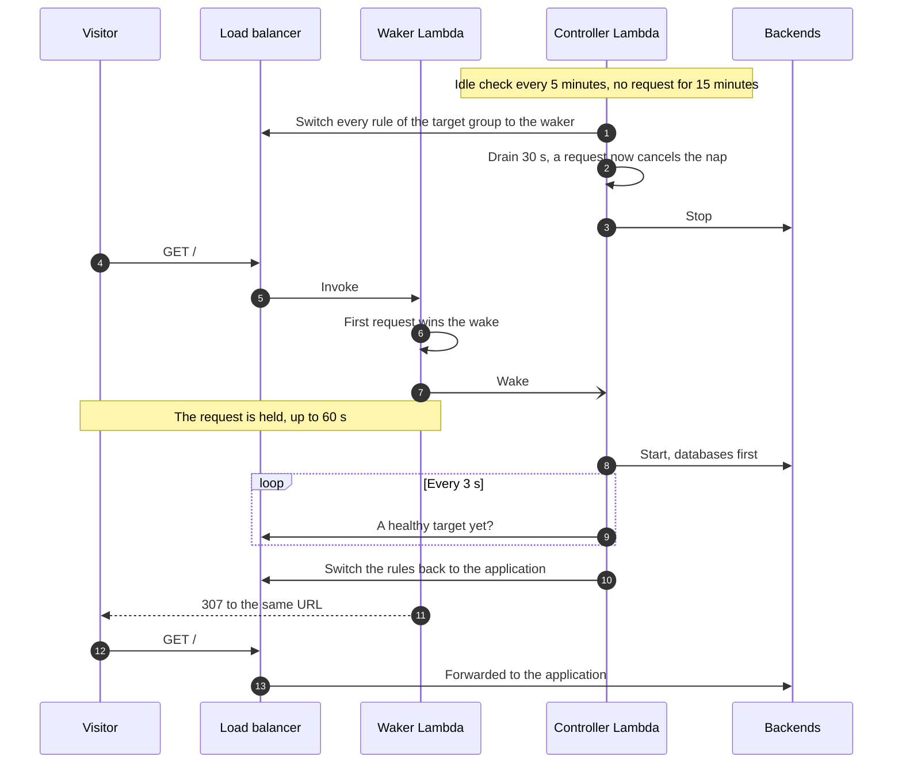

# Supported scenarios

What the router naps and wakes, as of router 0.29.0. A **workload** is an Application Load Balancer target group and
the backends behind it: the router naps them together once the target group has had no request for the idle window, and
wakes them on the next request. Each page below gives the scenario's diagram, the services it uses, its measured wake
time, its behavior and its limits.

| Scenario | What naps | Measured wake | Default wake timeout |
|---|---|---|---|
| [EC2 instances](ec2-instances.md) | Instances stopped, then started | 35–45 s | 600 s |
| [Auto Scaling groups](auto-scaling-groups.md) | Group scaled to 0, then given back its size | 35–44 s with a stopped warm pool, 41–51 s without | 600 s |
| [ECS services](ecs-services.md) | Desired count 0, Application Auto Scaling suspended | 25–57 s on Fargate | 600 s |
| [RDS and Aurora databases](databases.md) | Stopped after the application, started before it | 6–15 min with PostgreSQL | 1800 s (manager onboarding) |
| [Kubernetes on EKS](kubernetes.md) | Deployment or StatefulSet scaled to 0 | 22–26 s on EC2 nodes, 62–74 s on Fargate | 300 s (manager onboarding) |

A workload may combine backends: Auto Scaling groups and loose instances, an ECS service and its database, pods and
their database. Databases are always companions of an application's backends.

## The cycle

The defaults below are the Terraform `workload` module's and the manager's. The ranges are those the manager's
onboarding accepts; the `workload` module does not check them.

### Nap

1. **Idle detection.** Every 5 minutes, the controller reads the target group's `RequestCount` (CloudWatch, one-minute
   sums). A workload naps once it has been awake for the idle window (`idle_minutes`, 15 by default, 5 to 1440) and the
   target group had no request during it. A nap therefore starts 15 to 20 minutes after the last request, and the idle
   window is also the minimum awake time after a wake.
2. **Switch.** Every listener rule forwarding to the target group is switched to the workload's waker target group
   (weights 0 and 1). The nap is refused while a rule forwarding to the target group is not instrumented (an **issue**,
   shown in the status).
3. **Drain.** `drain_seconds` (30 by default, 0 to 300) lets the rule change reach every load balancer node (about 12 s
   measured) and the requests in flight end. A request reaching the waker during the switch or the drain cancels the
   nap: the rules go back to the application and nothing is stopped.
4. **Stop.** The backends are stopped (see each scenario), within 5 minutes. A request arriving during the stop is
   remembered and the wake starts as soon as the stop ends.

### Wake

1. **The first request wins.** A request reaching the waker that passes the filters (no-wake rules, `HEAD`, bots,
   scanner paths, IP reputation lists, wake mode) changes the state to `WAKING` with a conditional write. Only that
   request starts the wake. The others wait for it.
2. **Start.** The controller starts the databases first and waits until they are available, then the application's
   backends.
3. **Ready.** The controller checks the target group's health every 3 s. The first healthy target is enough: the rules
   are switched back to the application, and the other targets join as they become healthy.
4. **Answers while waking.**
   - **Held requests.** Up to `max_holders` (50 by default, 1 to 500) requests are held for up to `wait_seconds` (60 by
     default, 5 to 120). Each one checks the state every second. Once the workload is awake and 15 s have passed (the
     time for the rule change to show everywhere), a held request gets a `307` to the same URL, which the browser
     follows to the application. The method and body are kept.
   - **Other requests.** Requests that are not held, past the 60 s or beyond the 50 held, get the waiting page: a `503`
     with `Retry-After: 3`. The page checks every 3 s and reloads by itself once the application answers. Clients that
     do not ask for HTML get JSON, `{"status":"waking","retryAfter":3}`.
5. **Long wakes.** The controller Lambda runs for at most 15 minutes. A longer wake continues in a new invocation with
   the same wake id, until the workload's wake timeout counted from the first request.

### Failures

A wake that does not end in a healthy target within the wake timeout fails (`FAILED`) and says why: `capacity`, `quota`,
`permission`, `configuration`, `unhealthy`, `throttled`, `timeout`, `cluster` (Kubernetes) or `unknown`.

- **Seen early.** Auto Scaling launch failures, ECS tasks that cannot be placed and Kubernetes pods that cannot start are
  read every 30 s while the wake waits. A capacity shortage is waited out, since AWS and Kubernetes keep trying. Other
  failures end the wake at once.
- **Retried.** An EC2 instance or database start refused for capacity is tried again within the wake: after 30 s, 60 s,
  then every 120 s.
- **Backoff.** After a failure, requests get the waiting page with the time of the next attempt. They retry after
  `failed_retry_seconds` (60 by default), doubled after each failure in a row, at most 30 minutes. A wake asked from the
  manager does not wait.
- **No running cost.** A failed workload whose backends run without a healthy target is stopped once its idle window
  has passed, unless it is paused.

### Changes made outside Dormeto

Every 5-minute check also reconciles what changed outside Dormeto:
- an asleep or failed workload whose backends were all started by someone else, with a healthy target, becomes awake
  (`external-start`);
- an awake or failed workload whose backends were all stopped by someone else becomes asleep (`external-stop`);
- a database restarted by AWS after 7 days while its workload sleeps is stopped again;
- a nap stuck for 15 minutes, or a wake stuck past its timeout plus 60 s, is marked failed.

## What a wake's duration is made of

The measured times run from the first request to the application's first answer, on Dormeto's test workloads in
eu-west-1. Their target groups check health every 5 s and need 2 healthy checks, except the Kubernetes ones, which use
the AWS Load Balancer Controller's defaults (15 s, 2 checks).

| Part | Typical time | What you control |
|---|---|---|
| The waker's first invocation | 0.4 s, 2.3 s on a new Lambda container | — |
| The backends' start | 15–40 s for an instance or a task, minutes for a database | Instance or task size, image size, warm pools |
| The application's boot | Your application's | Boot time, lazy initialization |
| Health checks | Interval × healthy threshold, plus up to 3 s | Interval and threshold: AWS's defaults (30 s × 5) can add 2.5 minutes |
| The rule switch back | About 12 s, plus the 15 s held requests wait | — |

## Limits common to every scenario

- **Application Load Balancer only.** The router switches ALB listener rules and serves sleeping workloads from a Lambda
  target group. Network Load Balancers, API Gateway and CloudFront without an ALB origin are not supported.
- **Only requests through the load balancer wake a workload.** Calls that reach a backend another way (service
  discovery, ECS Service Connect, a pod or instance address, a queue consumer) neither wake it nor keep it awake.
- **Every rule forwarding to the target group must be instrumented.** Onboarding covers each one with a shadow rule. A
  listener default action forwarding to the target group, or a rule forwarding to other target groups too (blue/green,
  canaries), is an issue: the workload never naps while it exists, and is woken if it appears while the workload sleeps.
- **What the waker can answer.** While a workload sleeps or wakes, requests go to a Lambda function: AWS limits them to
  1 MB, and a WebSocket or streaming connection cannot be held, so it fails until the workload is awake. API clients
  must follow the `307`, or retry on the `503` and its `Retry-After`. In browser wake mode they wake the workload with
  the header `x-dormeto-wake: 1`.
- **The waker's timeout.** The waker's Lambda timeout is the `router` module's `waker_timeout_seconds` (70 s by
  default). It must exceed the largest `wait_seconds` of the router's workloads by at least 5 s: raise it with a
  `wait_seconds` above 65.
- **The load balancer's idle timeout.** Set it above the waker's Lambda timeout, so that a held request is not cut. The
  ALB default is 60 s. Dormeto's test load balancers use 120 s.
- **Lambda concurrency.** Each held request uses one waker execution for up to `wait_seconds`. The router's health warns
  when its waker's 24-hour peak, plus its other work, passes 80% of the account's concurrency limit in the region. New
  or rarely used accounts may have a limit of 10.
- **One router per account and region**, whose name has at most 15 characters.
- **Timing.** Naps start on the 5-minute check. A wake waits for the first healthy target, not for full capacity.
- **Wake timeout.** The manager's onboarding sets 600 s, 1800 s with a database and 300 s for Kubernetes. A workload
  written with the Terraform `workload` module keeps 600 s unless `wake_timeout_seconds` is set.
