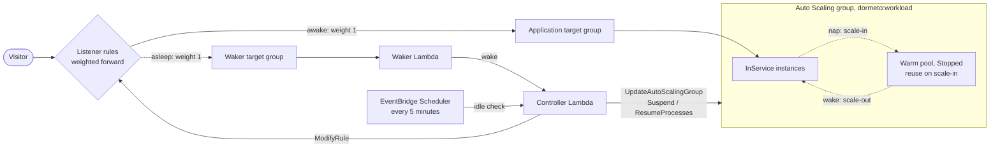

# Auto Scaling groups

One or more EC2 Auto Scaling groups feeding the workload's target group: the nap scales them to 0 with their scaling
processes suspended, the wake gives them back their size. With a warm pool in `Stopped` state, the instances wait
stopped in the pool instead of being terminated and launched again.



## Services

- **Amazon EC2 Auto Scaling:** the groups, their scaling processes and warm pools.
- **Elastic Load Balancing, Amazon EC2:** the rules, the target group's health, the instances' descriptions.
- **AWS Lambda, DynamoDB, EventBridge Scheduler, CloudWatch:** the router itself.

The router's role needs:
- `autoscaling:DescribeAutoScalingGroups` and `autoscaling:DescribeScalingActivities`;
- `autoscaling:UpdateAutoScalingGroup`, `autoscaling:SuspendProcesses` and `autoscaling:ResumeProcesses`, on groups
  tagged `dormeto:workload` only;
- `ec2:DescribeInstances` and the Elastic Load Balancing reads and `ModifyRule`.

It never launches instances itself: no `ec2:RunInstances` nor `iam:PassRole`.

## Wake time

**35–44 s measured with a stopped warm pool**, and **41–51 s without** (`t4g.nano` instances running a small web
server, health checked every 5 s with 2 healthy checks; 7 and 14 wakes).

Without a warm pool, each wake launches new instances: the AMI's boot, the user data and the application's
installation add to the time. With a warm pool, the instances only restart. Health checks at AWS's defaults (every 30 s,
5 healthy checks) can add up to 2.5 minutes.

## Behavior

**Discovery.** Groups tagged `dormeto:workload = <workload id>` whose target groups include the workload's are managed.
A workload may have several groups, and loose instances too. Instances of a group are never stopped one by one.

**Nap.**
1. The rules are switched to the waker, then the drain (30 s).
2. For each group, the router records its minimum, maximum and desired sizes.
3. It suspends the processes `AlarmNotification`, `ScheduledActions` and `AZRebalance`, so that scaling policies,
   scheduled actions and rebalancing leave the group at 0.
4. It sets the minimum and desired sizes to 0. The maximum is kept.
5. It waits until the group has no instance, at most 5 minutes. With a `Stopped` warm pool and reuse on scale-in, AWS
   returns the instances to the pool, stopped. Otherwise AWS terminates them.

A nap took about 55 s with the warm pool and 77–107 s without.

**Wake.**
1. Each group gets back its recorded sizes, with the maximum at least the desired size. A group found at 0 when the nap
   started gets the size of its tag `dormeto:wake-desired`, else 1.
2. The suspended processes are resumed.
3. Every 30 s, the router reads the group's scaling activities. A failed launch for lack of capacity is waited out, as
   Auto Scaling keeps trying, and the wake fails with it only at the wake timeout. Any other failure (a quota, a
   permission, the launch template) ends the wake at once.
4. The rules are switched back at the first healthy target.

**Advice.** The router's admin dashboard recommends, for a group:
- with no warm pool: add one in `Stopped` state with reuse on scale-in;
- with a `Running` pool: it is paid while the workload naps, use `Stopped` (or `Hibernated`);
- with a pool without reuse on scale-in: naps terminate the instances instead of returning them to the pool.

## Limits

- **With a warm pool, the application must start at boot.** User data runs at the instance's first boot only. A
  restarted instance from the pool must start the application from a system service.
- **No capacity fallback.** Instance types and launch templates are never changed. Use a mixed instances policy with
  several types for the capacity Auto Scaling can choose from.
- **Lifecycle hooks run as usual.** The nap waits up to 5 minutes for the group to be empty. A termination hook that
  holds the instances longer fails the nap.
- **Only the three processes above are suspended.** `Launch`, `Terminate`, `HealthCheck` and `ReplaceUnhealthy` keep
  running, which a scale to 0 needs.
- **One workload per group**, since the tag holds one workload id.
- **Discovery off in static mode.** A Terraform `workload` module with `instance_ids` set does not look for groups.

## Setup

Onboard the target group from the manager, which tags the groups and instruments the rules. With Terraform, use the
`workload` module and tag the group `dormeto:workload = <workload id>` (see the [README](../../README.md)). For faster
wakes, add a warm pool:

```hcl
resource "aws_autoscaling_group" "app" {
  # ...
  warm_pool {
    pool_state = "Stopped"
    instance_reuse_policy {
      reuse_on_scale_in = true
    }
  }
}
```
