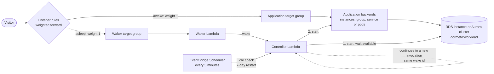

# RDS and Aurora databases

RDS DB instances and Aurora DB clusters tagged for a workload are its **companions**: they have no route of their own,
and nap and wake with the application's backends. The nap stops them after the application, the wake starts them and
waits until they are available before starting the application.

## Services

- **Amazon RDS and Aurora:** the DB instances and clusters.
- **Resource Groups Tagging API:** finding the databases tagged for the workload.
- The services of the application's own scenario, and the router itself.

The router's role needs:
- `tag:GetResources`, `rds:DescribeDBInstances` and `rds:DescribeDBClusters`;
- `rds:StartDBInstance`, `rds:StopDBInstance`, `rds:StartDBCluster` and `rds:StopDBCluster`, on databases tagged
  `dormeto:workload` only.

## Wake time

**6–15 minutes measured**, usually 12 to 14 (10 wakes of an ECS Fargate service with a PostgreSQL `db.t4g.micro`).

Starting the database takes nearly all of it, and the application starts only once the database is available. RDS
start times vary with the engine, the instance class and the storage. Visitors see the waiting page, which reloads by
itself: held requests give up after `wait_seconds` (60 s) and get it too.

## Behavior

**Discovery.** DB instances and Aurora clusters tagged `dormeto:workload = <workload id>` (found with the Resource Groups
Tagging API) are the workload's companions. An Aurora cluster is managed as a whole: tag the cluster, not its
instances.

**Nap.**
1. The application's backends nap first ([EC2 instances](ec2-instances.md), [Auto Scaling groups](auto-scaling-groups.md),
   [ECS services](ecs-services.md), [Kubernetes](kubernetes.md)).
2. Each database that is `available` gets `StopDBInstance` or `StopDBCluster`. The nap does not wait for them to be
   stopped.

**Wake.**
1. Each stopped database gets `StartDBInstance` or `StartDBCluster`. A database still stopping is started as soon as it
   is stopped.
2. A start refused for lack of capacity is tried again after 30 s, 60 s, then every 120 s.
3. The controller checks every 10 s until every database is `available`.
4. A wake longer than one controller invocation (15 minutes) continues in a new one, with the same wake id, until the
   wake timeout.
5. Then the application's backends start, and the rules are switched back at their first healthy target.

**The 7-day restart.** AWS starts a stopped database again after 7 days. The 5-minute check finds it running while the
workload sleeps and stops it again (`DatabaseRestopped` in the controller's logs).

## Limits

- **Set the wake timeout.** The manager's onboarding gives a workload with databases a wake timeout of 1800 s. A workload
  written with the Terraform `workload` module keeps 600 s, too short for most database starts: set
  `wake_timeout_seconds = 1800`.
- **Only for databases this workload uses alone.** The router stops a tagged database with its workload, whoever else
  uses it, and the tag holds one workload id.
- **Ignored:** read replicas and Aurora Serverless v1 clusters, which AWS cannot stop. They are shown in the status.
- **Aurora Serverless v2** clusters are stopped like any other cluster.
- **What AWS refuses to stop.** The router does not check it before onboarding: for example an instance that has read
  replicas, or a cluster in an Aurora global database.
- **A workload's databases always wake first**, all of them, even when the application could answer some requests
  without them.

## Setup

Tag the database `dormeto:workload = <workload id>`, with the same id as the application's backends. The manager's
onboarding of the target group tags the databases it is given and sets the 1800 s wake timeout.
