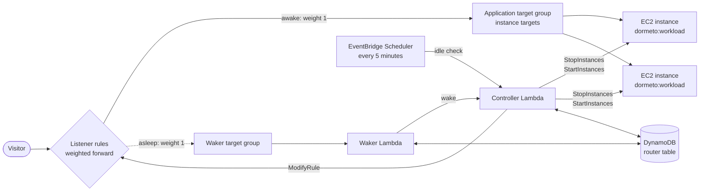

# EC2 instances

One or more EC2 instances registered in the workload's target group: the nap stops them, the wake starts exactly the
ones it stopped.

## Services

- **Elastic Load Balancing:** the listener rules and the target group's health.
- **Amazon EC2:** the instances.
- **AWS Lambda, DynamoDB, EventBridge Scheduler, CloudWatch:** the router itself (the waker, the controller, their
  state, the 5-minute check and the request counts).

The router's role needs:
- `ec2:DescribeInstances`;
- `ec2:StartInstances` and `ec2:StopInstances`, on instances tagged `dormeto:workload` only;
- for fallback instance types, `ec2:ModifyInstanceAttribute` (the instance type only) and `ec2:CreateTags` /
  `ec2:DeleteTags` (the tag `dormeto:instance-type`);
- the Elastic Load Balancing reads (rules, listeners, target groups, target health, tags) and `ModifyRule`.

## Wake time

**35–45 s measured** (about 30 wakes, `t4g.nano` instances running a small web server, health checked every 5 s with 2
healthy checks; median 38 s).

The instance's boot and the application's start take most of it. Larger instances and AMIs with many services boot more
slowly. Health checks at AWS's defaults (every 30 s, 5 healthy checks) can add up to 2.5 minutes.

## Behavior

**Discovery.** At each nap, wake and check, the router reads the target group's targets: every instance target tagged
`dormeto:workload = <workload id>` is managed. Instances that are untagged, tagged for another workload or members of an
Auto Scaling group are left alone and shown in the status. A static `instance_ids` list on the Terraform `workload`
module replaces discovery.

**Nap.**
1. The rules are switched to the waker, then the drain (30 s).
2. `StopInstances` on the instances that are pending or running.
3. The router waits until they are all stopped, at most 5 minutes.
4. An instance running on a fallback type is given back its own type.
5. The router waits up to 2 minutes for the target group to release the stopped instances (a warning only).

The nap records the instances it stopped: the wake starts exactly those. A nap took 43–60 s in the same tests.

**Wake.**
1. An instance still stopping is waited for, then `StartInstances` on the stopped ones.
2. A start refused for lack of capacity (`InsufficientInstanceCapacity`) is tried again after 30 s, 60 s, then every
   120 s, until the wake timeout.
3. With `fallback_instance_types` (at most 5, in order), an instance AWS has no capacity for is moved to the next type
   and started again. It gets its own type back after its next nap: a fallback is for one wake only.
4. The rules are switched back at the first healthy target. Instances stay registered in the target group while
   stopped, so nothing is registered again.

There is no early failure check for instances: a wake that never gets a healthy target fails at the wake timeout, as
`unhealthy` (with the target's reason) or `timeout`.

## Limits

- **Instance targets only.** IP targets in the target group are ignored, never napped.
- **One workload per instance**, since the tag holds one workload id.
- **Instances of an Auto Scaling group** are never stopped one by one: tag the group instead
  ([Auto Scaling groups](auto-scaling-groups.md)).
- **What AWS does on a stop applies.** The router does not check it before onboarding:
  - an instance without an Elastic IP gets a new public IPv4 address at each start (traffic through the load balancer
    is not affected);
  - instance store volumes are emptied;
  - AWS refuses to stop instances with an instance store root volume, and Spot instances not launched from a persistent
    request.
- **Fallback instance types** need `ec2:ModifyInstanceAttribute` in the router's role and `DmtRouterBoundary` (router
  0.25.0). They apply to loose instances only, never to an Auto Scaling group's launch template.

## Setup

Onboard the target group from the manager, which tags the instances and instruments the rules. With Terraform, use the
`workload` module and tag the instances `dormeto:workload = <workload id>` (see the [README](../../README.md)).
