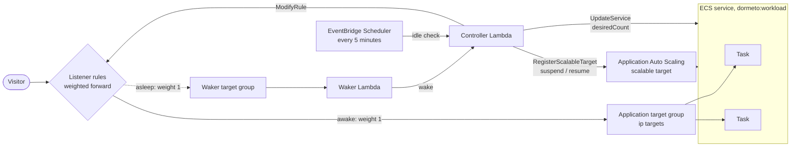

# ECS services

One or more Amazon ECS services whose tasks feed the workload's target group, on Fargate, Fargate Spot or EC2 capacity:
the nap sets their desired count to 0 with their Application Auto Scaling suspended, the wake gives both back.

## Services

- **Amazon ECS:** the services, their events and task definitions.
- **Application Auto Scaling:** the services' scalable targets.
- **Resource Groups Tagging API:** finding the services tagged for the workload.
- **Elastic Load Balancing:** the rules and the target group's health.
- **AWS Lambda, DynamoDB, EventBridge Scheduler, CloudWatch:** the router itself.

The router's role needs:
- `tag:GetResources`, `ecs:DescribeServices`, `ecs:DescribeTaskDefinition` (the task size, for the savings) and
  `application-autoscaling:DescribeScalableTargets`;
- `ecs:UpdateService`, on services tagged `dormeto:workload` only;
- `application-autoscaling:RegisterScalableTarget`;
- the Elastic Load Balancing reads and `ModifyRule`.

## Wake time

**25–57 s measured on Fargate** (19 wakes, a 0.25 vCPU / 512 MB task with a small image, health checked every 5 s with
2 healthy checks).

Fargate's capacity, the image's download and the container's start take most of it: a smaller image starts sooner. On
EC2 capacity, a task placed on a running instance with room starts in seconds. When the cluster must first launch an
instance, its launch and registration add to the wake.

## Behavior

**Discovery.** Services tagged `dormeto:workload = <workload id>` (found with the Resource Groups Tagging API) whose
load balancers include the workload's target group are managed. A workload may have several services.

**Nap.**
1. The rules are switched to the waker, then the drain (30 s).
2. For each service, the router records its desired count and, if it has a scalable target, its minimum and maximum.
3. A scalable target gets a minimum of 0, with dynamic scale-in, dynamic scale-out and scheduled scaling suspended.
4. The desired count is set to 0.
5. The router waits until each service has no desired, pending or running task (every 3 s, at most 5 minutes).
6. The workload's databases are stopped after the services ([databases](databases.md)).

A nap took 34–70 s.

**Wake.**
1. The databases start first, if any.
2. Each service gets back its desired count. A service found at 0 when the nap started gets the count of its tag
   `dormeto:wake-desired`, else 1.
3. Its scalable target gets back its minimum and maximum (at least the desired count), with scaling resumed.
4. Every 30 s, the router reads the service's events. A task that cannot be placed for lack of capacity is waited out,
   as ECS keeps trying, and the wake fails with it only at the wake timeout. Any other failure (an image that cannot be
   pulled, a task that cannot start) ends the wake at once.
5. The rules are switched back at the first healthy target.

## Limits

- **EC2 capacity is not stopped.** The router sets the services' desired count only. The cluster's instances keep
  running, and billing, unless a capacity provider with managed scaling scales them in. The savings count Fargate tasks
  only.
- **Blue/green deployments.** CodeDeploy and ECS blue/green deployments switch listener rules between two target groups.
  A rule forwarding to another target group besides the application's and the waker's is an issue, and blocks naps
  while it exists.
- **Only requests through the load balancer wake the service.** Calls through Service Connect, Cloud Map or a task's
  address do not.
- **One workload per service**, since the tag holds one workload id.
- **Long stop timeouts.** The nap waits at most 5 minutes for the tasks to stop.

## Setup

Onboard the target group from the manager, which tags the services and instruments the rules. With Terraform, use the
`workload` module and tag the service itself `dormeto:workload = <workload id>` (see the [README](../../README.md)).
