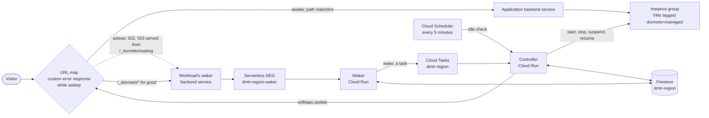
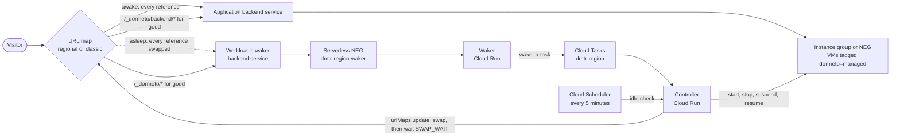

# Google Cloud: Compute Engine VMs

Compute Engine VMs in unmanaged instance groups, managed instance groups (zonal or regional) or zonal network endpoint
groups, behind a backend service of an **external Application Load Balancer**: global (`EXTERNAL_MANAGED`), regional
(`EXTERNAL_MANAGED`, in the router's region) or classic (`EXTERNAL`). The nap suspends or stops them, the wake starts or
resumes the ones it napped. The router runs in your project as two Cloud Run services, and `dormeto gcp install` puts it
there: router 0.34.0 for groups behind the global load balancer; from router 0.37.0, [zonal network endpoint
groups](#zonal-network-endpoint-groups), [the regional and classic load balancers](#regional-and-classic-load-balancers-the-swap),
[schedules and pauses](#schedules-and-pauses) and [IP lists](#ip-lists).

The global load balancer keeps the application's backend service in its URL map and serves the waiting page through a
custom error response (the diagram, and [Behavior](#behavior)). The regional and classic ones have no custom error
response, so the router swaps the URL map's references to the application at each nap and wake (their section). Cloud
SQL instances nap with a workload as its companions ([Google Cloud: Cloud SQL databases](google-cloud-sql.md)), and GKE
pods behind standalone network endpoint groups have their own page ([Google Cloud: Kubernetes on
GKE](google-kubernetes-engine.md)).



## Services

- **Cloud Load Balancing:** the URL map, the application's backend service and, per workload, a backend service
  `dmtr-<region>-<workload>` on the router's serverless NEG `dmtr-<region>-waker`, with the custom request header
  `x-dormeto-workload: <workload>` (and `x-dormeto-switch: swap` on a classic load balancer; a regional waker backend
  service has none, its URL map carries them: [the swap](#regional-and-classic-load-balancers-the-swap)).
- **Compute Engine:** the VMs, their groups and autoscalers, and the zonal network endpoint groups naming VMs.
- **Cloud Run:** the waker `dmtr-<region>-waker` (ingress internal and Cloud Load Balancing, no invoker check, 0 to 10
  instances, 80 concurrent requests, 256 MiB, or 512 MiB once an IP list is set, timeout 120 s) and the controller
  `dmtr-<region>-controller` (invoker check on, at most 10 instances, 10 concurrent requests, 512 MiB, timeout 1800 s).
  Both get CPU during requests only, so an idle instance costs nothing. One container image, `DMT_ROLE` picks the role.
- **Firestore, Cloud Tasks, Cloud Scheduler, Cloud Monitoring:** the router's state (database `dmtr-<region>`), its
  asynchronous actions (queue `dmtr-<region>`: 3 attempts, 5 to 60 s apart), the check every 5 minutes (job
  `dmtr-<region>-check`) and the request counts.

The router runs as the service account `dmtr-<region>@<project>.iam.gserviceaccount.com`, whose custom roles
`dormetoRouter` and `dormetoRouterBackends` are in `gcp/access.json`, permission by permission. The router cannot
change IAM. The VMs start, stop, suspend and resume only with the tag `dormeto=managed` (a secure tag the onboarding
binds to the workload's VMs and groups).

## Wake time

**About 15–20 s after a resume, 43 s after a start** for a VM, **28 s after a resume, 40–43 s after a start** for a
managed group of two: from the wake request to the workload awake, through the router, with a small web server on `e2`
VMs and a health check every 5 s with 2 healthy checks.

| Measured through the router (2026-10-30, 6 runs) | Wake request to `AWAKE` | Browser: page opened to application shown |
|---|---|---|
| VM, resume | 14.8 s, 19.8 s | 16.8 s |
| VM, start | 42.6 s | |
| Managed group of two, resume | 28.2 s | 31.8 s |
| Managed group of two, start | 40.3 s, 43.1 s | 44.7 s |

Compute Engine's own times, measured through the load balancer before the router existed, five runs each: 13–25 s after
a resume and 37–41 s after a start for a VM, 28–34 s and 37–43 s for the group. So the router adds no delay that these runs
can tell apart, and the page's probe every 3 s adds at most 3 s. At a health check of 1 s, Compute Engine's times were 13 s
after a resume and 30–39 s after a start: set the health check to 1 s for the fastest wakes.

A waker with no instance running starts in about a second: the first page took 1.7 s, the others about 30 ms.

These times are the global load balancer's, with instance groups. Zonal network endpoint groups and the regional and
classic load balancers have their times in their own sections below.

## Behavior

This section is the global load balancer's. The regional and classic ones change the URL map instead: [the
swap](#regional-and-classic-load-balancers-the-swap).

**There is no switch at the wake.** A URL map change takes 3 to 3.5 minutes to reach every request on the global load
balancer (measured), far beyond what a request can wait. So the application's backend service stays in the URL map for
good, and the nap uses the load balancer's **custom error response** instead.

**Nap.**
1. In each path matcher of the URL map that names the application's backend service (a map's default service gets a
   matcher `dormeto-default` of its own at the onboarding: a policy on the map itself would cover the whole load
   balancer), the router writes a custom error response policy: the load balancer's `502` and `503`, which it answers
   when no backend is healthy, are served from the workload's waker backend service at `/_dormeto/waiting`, with the
   status overridden to `503`. One `urlMaps.update` each, with the map's fingerprint; refused because of another update
   of the map, it is read again and retried with a pause, up to 60 s. A service that no URL map names any more, or that
   another URL map names too, is not napped: the workload stays awake, nothing is stopped, and the log says why.
2. It waits 300 s for the change to reach the load balancer (measured: 163–215 s). The application serves during that
   wait: it is the drain. A whole nap takes 6.5 to 8 minutes (measured).
3. It stops the VMs, or suspends them when the `hibernate` setting is on and the VM can be suspended (no GPU, no TPU,
   not confidential, at most 208 GB of memory; a refused suspension falls back to a stop). A managed group is napped
   through the group (`stopInstances`, `suspendInstances`), which keeps the VMs as a standby pool: none is re-created
   (but see the 60 days in the limits).
   Its autoscaler, if any, is turned off for the nap.

**While asleep.** Every request gets the waiting page (a `503` with `Retry-After`), served by the waker: the waker
answers the load balancer's fetch with a `200`, and the policy's override gives the visitor the `503`. The page's script
probes `/_dormeto/wake`, a route the onboarding added to the URL map for good, which goes through the same request
filters as on AWS (bots, scanners, no-wake rules) before it wakes the workload. API clients wake it with
`POST /_dormeto/wake`, answered with a `202`, JSON and the headers `x-dormeto-state` and `Retry-After` (a `200` once
awake): the waker answers no `503` there, which the policy would replace with the page. A plain request does not wake: the error response's fetch may not carry the visitor's request, and
waking on it would let every scanner wake the workload. The page reloads the visitor's address once the workload is
awake.

What the error response's fetch carries (measured): always a `GET` of `/_dormeto/waiting`, whatever the visitor's method and
path, with the visitor's query string, `Host`, `User-Agent`, `Referer` and address. So the waker could read who asks but not
what for, which is why a plain request still does not wake.

**Wake.**
1. The waker asks the controller for the wake through a task. The first request wins, as on AWS.
2. The controller starts or resumes the VMs (a managed group: `startInstances`, `resumeInstances`, then the autoscaler
   gets its mode back), and polls the backend service's health every 2 s.
3. At the first healthy instance the workload is `AWAKE`, and the error response policy is removed from the URL map.
   Until it is, the load balancer already sends requests to the VMs as soon as they are healthy: nothing needs to
   propagate. After it, the application's own `502` and `503` are its own again.

A wake that gets no healthy instance within the wake timeout (600 s by default) fails and says why, as on AWS; a start
refused for lack of capacity (`ZONE_RESOURCE_POOL_EXHAUSTED`) is a capacity failure, with the same backoff. There is no
fallback machine type.

**Idle check (every 5 minutes).** For each awake workload, the router reads the application's backend service's
`request_count` over the idle window, through any URL map (Cloud Monitoring publishes it 72–125 s late, and a single request can be missed:
the effective idle window is that much longer). None: nap. For each workload asleep, it checks the URL map still holds
the error response policy and the `/_dormeto/*` route (else it repairs them), and that the VMs are still down: a VM
started by hand makes the workload awake, and VMs all stopped by hand while it is awake make it `ASLEEP` with the cause
`external-stop`, as on AWS. A wake asked during a nap is kept: during the wait the nap gives up, no VM is stopped and the policy is removed; once the
VMs are going down, the workload wakes as soon as the nap ends.

**A nap that dies.** A nap runs in one request of the controller. If that request ends before the nap does (a new
revision of the controller during it, for example), the check finds the nap still `NAPPING` and has it called stuck
after 35 minutes: the workload is then `FAILED`, and the next wake works. Until then a visitor's wake waits for the nap,
so a workload whose VMs it had begun to stop stays asleep that long. Under a swap with no VM stopping yet, 15 minutes
([the swap's limits](#limits-of-the-swap)).

**Offboarding.** `DELETE /v1/workloads/<id>` (the CLI) removes the policy, the route and the waker backend service. With
`force=true` it does so for a workload that cannot wake, and leaves its VMs down, saying so.

## Zonal network endpoint groups

**From router 0.37.0, not accepted yet.** The VMs' times below were measured on Google (2026-10-31); the acceptance, which
naps and wakes such a workload through the router, has not run.

A backend of the application's backend service may be a zonal network endpoint group (NEG) of type `GCE_VM_IP_PORT`,
each endpoint naming a VM. The onboarding reads the endpoints, and their VMs are napped as an unmanaged group's are:
tagged `dormeto=managed` by the CLI, stopped or suspended, then started or resumed, with the same rules for suspending.
A stopped or suspended VM keeps its endpoint (measured), and the custom error response catches the `503` of a NEG whose
VMs are down as it does for a group: the waiting page came about 2 s after the stop. On a regional or classic load
balancer the swap applies to them as to a group's VMs.

**A nap acts only on what still is the NEG.** Each VM's record names its NEG. The nap reads the NEGs' endpoints before it
writes anything, and again just before it stops a VM: a VM added or removed, an endpoint naming no VM, or a NEG deleted
since the onboarding gives the nap up (cause `backends-changed`, said in the log), nothing stopped, the workload awake.
Every later nap gives up the same way until the workload is offboarded and onboarded again. A wake starts what was
recorded.

| Measured with the measuring tool (2026-10-31), a VM in a zonal NEG | Stop or suspend | Start or resume |
|---|---|---|
| Stopped VM, 5 runs each way | no instance healthy after 9–11 s, stopped after 106–107 s | running after 8–39 s, healthy after 33–64 s, the application answering steadily after 38–75 s |
| Suspended VM, 3 runs | no instance healthy after 25–27 s, suspended after 26–51 s | healthy after 11–13 s, the application answering steadily after 13–18 s |

These are Compute Engine's times through the load balancer, before the router's code: no wake of a NEG's VM through the
router has been timed yet. One request of the first run hung for its 6 s right after the stop, as with groups.

### Limits of zonal NEGs

- **Refused at the onboarding, each with what to change:** a NEG of another type (serverless, internet, private service
  connect, `NON_GCP_PRIVATE_IP_PORT`), a NEG with no endpoint, an endpoint that names no VM, a VM of a managed group (a
  stopped VM is the group's to repair: put the managed group in the backend service instead of its VM in a NEG), and a
  NEG GKE made, whose endpoints are pods, unless it is onboarded as pods ([Kubernetes on
  GKE](google-kubernetes-engine.md)).
- **A VM added to or removed from a NEG while the workload sleeps is found at its next nap,** which gives up: the wake
  starts only the VMs recorded. After changing a NEG's endpoints, offboard and onboard the workload again; until then it
  stays awake, and only the log says why.
- **The router's permission:** `compute.networkEndpointGroups.get`, which `listNetworkEndpoints` asks too.
- **Terraform.** A nap changes no endpoint (a stopped VM keeps its own), so a NEG's endpoints need no `ignore_changes`;
  its VMs need what any VM needs ([Limits](#limits)).

## Regional and classic load balancers: the swap

**From router 0.37.0, not accepted yet.** A nap and a wake were measured through the router once on each kind
(2026-11-04), the URL maps' changes beforehand (2026-10-31); the acceptance has not run.

A regional or classic external Application Load Balancer has no custom error response: Google refuses the policy on both.
So the router changes the URL map itself, one `update` at each nap and one at each wake: every reference to the
application's backend service (the map's default, a path matcher's default, path rules, route rules, weighted services)
becomes the workload's waker backend service, and back. A map's change reaches the load balancer slowly, so each one is
followed by a wait, SWAP_WAIT: 100 s on a regional load balancer, 250 s on a classic one (measured: the last old answer
up to 89 s after a regional change; a classic change settled up to 226 s after its update). Google retires the classic
load balancer and offers a migration to the global one, whose wake does not wait for a map's change: prefer it.



### Onboarding

- **The kind is read from Google:** the URL map is looked for globally and in the router's region, and its forwarding
  rules' scheme tells a global load balancer from a classic one. `dormeto gcp workloads onboard --load-balancer
  global|regional|classic` says it when the same name exists in both, which is refused otherwise. A regional load
  balancer of another region is refused: onboard it on that region's router. A map with forwarding rules of both a
  global and a classic load balancer (a migration under way) is refused until the migration ends.
- **The waker backend service follows the kind:** regional in the router's region (`regionBackendServices`), or global
  with the scheme `EXTERNAL` on a classic load balancer, both on the router's serverless NEG.
- **The hold route.** Google does not health check a backend service that no forwarding rule reaches, and a wake waits
  for a healthy instance. So the onboarding adds for good, beside `/_dormeto/*`, the route `/_dormeto/backend/*` to the
  application's backend service: it keeps the service in the map through a swap, health checked (measured: healthy 35 s
  on classic and 40 s on regional after a start, 9 s and 14 s after a resume). A request there reaches the application,
  or Google's `503` while it sleeps, and the application sees that path. With route rules, the hold route takes priority
  0 and the waker's route priority 1: both must be free.
- **A regional waker's headers are in the map.** Google refuses custom request headers on a regional backend service
  (measured: a `400` at the insert). So a regional waker backend service has none, and its description says whose waker
  it is (`Dormeto: the waker of workload <id>`), which a later onboarding of the same workload reads. Wherever the regional
  map names the waker, it names it as a one-entry weighted service (`weight: 100`) whose header action adds
  `x-dormeto-workload` and `x-dormeto-switch: swap` with `replace: true`, which replaces a client's own value: on the
  `/_dormeto/*` route, and at a swap in place of each reference. A plain reference (`defaultService`, `service`) gets a
  third header, `x-dormeto-ref: service`, so that the unswap writes the plain reference back; a weighted reference of
  yours keeps its weight and its own header action, Dormeto's headers added to it and taken out again. On global and
  classic load balancers the waker backend service carries its headers itself. On each kind a client's own
  `x-dormeto-workload` or `x-dormeto-switch` never won (measured).
- **Refused:** a map whose `tests` or `requestMirrorPolicy` name the application (Google validates the tests at each
  update, and a swap would fail them, or leave a mirror), and a weighted route sending to the application and to other
  services (a swap would change their shares).

### Nap, sleep and wake

**Nap.**
1. The NEGs' endpoints are read: unchanged, or nothing is written ([zonal NEGs](#zonal-network-endpoint-groups)).
2. The swap is written. Visitors reach the waiting page as it spreads.
3. The router waits SWAP_WAIT: the application's drain and the change's spread.
4. The swap is written again, to be sure: a check's repair or a Terraform apply may have taken it away meanwhile.
5. The endpoints are read again, then the VMs stopped or suspended.

Measured through the router: on classic, a nap in 5.5 minutes (the swap, 250 s, then the VM suspended after another
minute); on regional, the waiting page reached visitors 53 s after the nap began, and the workload was `ASLEEP` 3.5
minutes after it began (100 s, then the VM suspended).

**While asleep.** The waker gets the visitor's real request, its method, path and body, with no policy to change its
answer: a `200` would tell an API client it succeeded. So under a swap the waker answers the waiting page as a `503` with
`Retry-After`, whatever the method, and a request with a body gets the page too, unlike on the global load balancer. A
plain request still does not wake: the page's probe of `/_dormeto/wake` and `POST /_dormeto/wake` do, as on the global
load balancer. The load balancer does not retry the waker's `503` (measured: one waker request per visitor's request).
The waker knows it is behind a swap from the header `x-dormeto-switch: swap`, so it answers rightly even when Firestore
cannot be read.

**Wake.**
1. The controller starts or resumes the VMs.
2. It waits for one healthy instance, which the hold route makes possible.
3. It unswaps the map.
4. It waits SWAP_WAIT, then the workload is `AWAKE`, so that the page's reload lands on the application.

The map's change is part of the wake's time. The default wake timeout adds SWAP_WAIT: 700 s for VMs on a regional load
balancer, 850 s on a classic one. A VM that cannot start while another one is healthy does not keep visitors at the
waker: `BackendsNotWoken` is logged, the map is unswapped and the workload is `AWAKE`.

**A nap given up** (a wake asked during it, a pause, a changed NEG, a map Google refuses): the router unswaps the map,
waits SWAP_WAIT, then the workload is `AWAKE`; with nothing swapped yet, there is no wait. Visitors stay at the waker
until the unswap has spread.

**The check.** Every 5 minutes the map is put back as the state says: a swap written by hand on an awake workload was
repaired at the next check, 43 s later (measured, logged `RouteDrift`). VMs started by hand while the workload sleeps
make it awake through a wake, which unswaps and waits (`external-start`).

**Idle signal.** Classic: `loadbalancing.googleapis.com/https/request_count`, resource `https_lb_rule`, as on the
global load balancer. Regional: `loadbalancing.googleapis.com/https/external/regional/request_count`, resource
`http_external_regional_lb_rule`, with the region in the filter. Both by the backend service's plain name, read back
with real traffic (measured); the first point came 84 s (classic) and 51 s (regional) after the requests.

**Offboarding** puts the application back wherever the map is still swapped and removes the hold route and the
waker's route, in one update, then deletes the waker backend service. Measured: a classic offboarding in 1 min 42 s, the
map back as before its onboarding.

### Wake time of the swap

| Measured through the router (2026-11-04, one run each, a suspended VM) | Nap | A visitor's `POST /_dormeto/wake` to the application answering steadily |
|---|---|---|
| Classic | 5.5 minutes | 2 min 16 s |
| Regional | 3.5 minutes to `ASLEEP` | 62 s |

The maps' own changes, measured before the router's code: a classic map's update took about 17 s, then the first new
answer came after 38–123 s, the last old one after 76–221 s, settled after 78–226 s, with 3 to 11 answers `502` at the
change (5 runs). A regional map settled 35 s after its update's end, but the update itself took 85 s (6 to 26 s in
earlier runs), with one answer `503`.

### Limits of the swap

- **Set a wake timeout that leaves room for the map's change.** The default adds SWAP_WAIT (above). A `--wake-timeout`
  of SWAP_WAIT plus 60 s or less (160 s regional, 310 s classic) is refused at the onboarding, as a wake would always
  fail; about 250 s or more on a regional load balancer and 340 s or more on a classic one is advised.
- **Classic's redirect on an HTTP-only front end.** Right after a classic map's change first sends a path to the waker
  (the onboarding's route, a nap's swap), Cloud Run answered that load balancer's plain-HTTP requests with a 302 to
  `https://` for about 40 s (measured: 20 answers in 37 s, then none). Behind an HTTPS front end it is harmless; on an
  HTTP-only one, visitors get that redirect, an error, for that moment. Serve a classic load balancer over HTTPS, or
  migrate it to the global one. The global load balancer over HTTP showed none.
- **A visitor at a nap's start waits up to 2 × SWAP_WAIT with the VMs running.** A visitor who reaches the waiting page
  while a nap waits for its swap wakes the workload, but the nap gives up only at the end of its wait, then unswaps and
  waits again: up to 200 s on regional and 500 s on classic on the waiting page, though no VM stopped. A longer idle
  window makes it rarer.
- **A nap that dies under a swap holds visitors up to 15 minutes.** If the nap's request ends while the map is swapped
  and no VM is stopping yet (a new revision of the controller, for example), visitors get the waiting page and their
  wakes wait until the check calls the nap stuck, after 15 minutes (35 minutes once a VM is stopping); the workload is
  then `FAILED`, and the check's wake brings it back.
- **A request with a body gets the page under a swap**, a `503`, for any method: API clients should read a `503` as
  asleep, send `POST /_dormeto/wake`, then retry their request.
- **Ten naps on one regional URL map.** A regional map's update took 85 s (measured), and a nap retries a map busy with
  another update for about 120 s. So of ten workloads on one regional map that nap together, in one nap window, only 2
  or 3 may nap (by arithmetic, not measured yet): the others' naps fail (`NapFailed`), with that window's occurrence spent,
  and they nap later by their idle window. Give workloads of one regional map different nap windows, or maps of their own.
- **A header of your own named `x-dormeto-*` on a regional map's swapped entry is replaced at the swap and not given
  back** at the unswap: the `x-dormeto-` headers are Dormeto's. Name your own headers otherwise.
- **Your routes under `/_dormeto/`.** `/_dormeto/*` and `/_dormeto/backend/*` are Dormeto's: a route of your own under
  `/_dormeto/` makes the workload ineligible.
- **One router per region.** A regional load balancer is onboarded on the router of its region.
- **Terraform.** A regional (`google_compute_region_url_map`) or classic (`google_compute_url_map`) URL map changes at
  each nap and wake, and holds Dormeto's routes (and, on regional, the waker's headers): ignore
  `lifecycle { ignore_changes = [default_service, default_route_action, host_rule, path_matcher] }`. Otherwise an apply
  puts the application back in a sleeping workload's map, and the visitors get Google's error until the next check
  swaps it again. The demo's regional and classic maps have it; that `terraform plan` then shows no change is the
  acceptance's to check.
- **Idle signal.** A metric filter that matched nothing would read 0 and nap a busy workload. The filters were read back
  with real traffic; that steady traffic keeps each kind awake through the router is the acceptance's to check.

## Schedules and pauses

**From router 0.37.0, not accepted yet.** The acceptance has not run.

As on AWS: a workload's schedule of nap and awake windows, with exceptions and `maxNapDays`, in its time zone, in the
same JSON (the CLI's README has it), and pauses with a reason. Through the controller, as the operator:

```
dormeto gcp workloads schedule show|set|clear <id> [--file schedule.json]
dormeto gcp workloads pause <id> --reason <text> [--keep-asleep] [--until <time>]
dormeto gcp workloads resume <id>
```

Each takes `--project` and `--region`. `schedule show` prints the next events; a schedule the controller refuses is
answered with what is wrong.

- **Schedules.** Each check applies every scheduled workload before its idle loop: a nap window naps the workload, an
  awake window wakes it, and a nap within 30 minutes of an awake window's start is skipped. Inside a nap window nothing
  wakes the workload on traffic, `POST /_dormeto/wake` included, unless the window's `wake` is `header` (its default is
  `never`); the waiting page tells the visitor when the window ends.
- **Scheduled naps are spread.** A nap holds a controller request for minutes, so the check enqueues at most 10
  scheduled naps each run, oldest occurrence first, and the next check takes the rest: 30 workloads in one nap window nap
  within 15 minutes. Wakes are never held back.
- **Pauses.** A pause holds every nap (idle, scheduled, or asked with `nap`), and wakes a workload asleep, unless
  `--keep-asleep`. A nap asked before the pause is refused at its start and at its commit point. `--until` ends the pause
  at a time (RFC 3339, at most 366 days away), `resume` ends it now.
- **`--keep-asleep` holds the scheduled and maintenance wakes only.** With `--keep-asleep`, a visitor still wakes the
  workload, as on AWS.
- **`maxNapDays`** wakes a workload asleep for that many days. Google Cloud forces no wake of its own, so it is only
  your setting.

### Limits of schedules and pauses

- **A scheduled nap's occurrence is spent once its task is accepted.** A pause, a refused nap or a lost task costs that
  window's nap: it does not come back when the pause ends. The idle check still naps the workload by its idle window.
- **A pause is a workload's.** Router-wide pauses and exclusions wait for the manager on Google Cloud.
- **Many workloads of one regional URL map in one nap window:** see [the swap's limits](#limits-of-the-swap).

## IP lists

**From router 0.37.0, not accepted yet.** The acceptance has not run.

The router ignores the addresses of the IP lists named at its install, for every workload:
`dormeto gcp install --ip-list name=<n>,url=<u>[,refresh=<hours>]`, repeatable. A run with `--ip-list` replaces the set,
`--no-ip-lists` clears it, and a run with neither keeps it, a later `--image` included. Either flag changes the two Cloud
Run services (`DMT_IP_LISTS`), so it needs the router installed: without `--image`, the recorded image is reused. A
list's URL starts with `http://` or `https://` (no `s3://`, no credentials; its query string is printed and stored). The
check has each list downloaded when it is due (`refresh`, 24 hours by default), as a task of its own, and the waker holds
the lists in memory, at 512 MiB once one is set.

Only the action ignore exists here: a listed address's `GET /_dormeto/wake`, the waiting page's probe, never wakes the
workload, and its visitor keeps the page. `POST /_dormeto/wake` is an explicit wake, which the lists do not judge: it
wakes the workload, from any address.

### Limits of IP lists

- **An IP list stops browsers and scanners on those addresses, not an API client that means to wake** with
  `POST /_dormeto/wake`.
- **The lists are the router's,** for all its workloads; a catalog of lists waits for the manager on Google Cloud.
- **The address the waker reads** is the last entry of `X-Forwarded-For` before the load balancer's own. Which address
  that is behind each kind of load balancer, a forged header included, was not measured yet: the acceptance reads it
  from real wakes.

## Limits

- **External Application Load Balancers only:** global, regional (in the router's region) and classic. Internal load
  balancers and Cloud Run backends are not supported (Cloud Run scales to zero by itself), nor are the load balancers
  GKE makes from a Gateway or an Ingress ([Kubernetes on GKE](google-kubernetes-engine.md)). The limits of each part
  added in router 0.37.0 are in its own section above: zonal NEGs, the swap, schedules and pauses, IP lists.
- **A global load balancer's URL map written in Terraform must ignore what Dormeto writes.** The nap writes the custom error response policy
  (`default_custom_error_response_policy`, on each `path_matcher` naming the application's backend service), and the
  onboarding adds the route `/_dormeto/*` to those path matchers (a `path_rule` with `paths = ["/_dormeto/*"]`, or, when
  the matcher has `route_rule`s, a `route_rule` of priority 0); when the map's own default names the service, it adds a
  `host_rule` `*` and a `path_matcher` `dormeto-default` to hold them. Ignore those fields:
  `lifecycle { ignore_changes = [host_rule, path_matcher] }`. Otherwise `terraform apply` removes them: the workload is
  then expected to show the load balancer's own error page while it is asleep, and not to wake from its browser, until
  the 5-minute check repairs the map. The trade-off: later edits of your path matchers must go outside Terraform's plan,
  or by removing the ignore for that apply, which removes Dormeto's fields too until the check writes them back. A custom
  error response policy of your own on a path matcher that names the backend service, or a route of your own under
  `/_dormeto/`, makes the workload ineligible.
- **The VMs and groups written in Terraform must ignore what a nap changes.** On `google_compute_instance_group_manager`
  and `google_compute_region_instance_group_manager`, `ignore_changes = [target_size, target_stopped_size,
  target_suspended_size]`: a nap moves the VMs from the target size to the stopped or suspended size (measured), so an
  apply would move them back and could create new VMs. On `google_compute_autoscaler` and
  `google_compute_region_autoscaler`, `ignore_changes = [autoscaling_policy[0].mode]`: a nap turns it off. On
  `google_compute_instance`, `ignore_changes = [desired_status]` if you set it: an apply would start a napped VM. These
  field names pass `terraform validate`; no apply was run against a napped workload. The tag's binding is not a field of
  these resources, so it needs nothing.
- **From router 0.37.0, not accepted yet: the other fields to ignore in Terraform** are on their pages: a regional or
  classic load balancer's URL map in [the swap's limits](#limits-of-the-swap), a Cloud SQL companion on [Google Cloud:
  Cloud SQL databases](google-cloud-sql.md#limits), a GKE workload's Deployment or StatefulSet on [Kubernetes on
  GKE](google-kubernetes-engine.md#limits).
- **A path matcher naming another service too** shows the waiting page for that service's own `502` and `503` while the
  workload is asleep.
- **A request with a body gets Google's error, not the page, on the global load balancer.** While asleep, a `POST`,
  `PUT`, `PATCH` or `DELETE` with a body gets Google's plain `503` (`unconditional drop overload`, no `Retry-After`): the load balancer does not use the
  custom error response for it (measured). The same request without a body gets the page. API clients should read a `503` as
  asleep, send `POST /_dormeto/wake`, then retry their request.
- **The last requests of a nap.** Stopping or suspending a VM that is not in a managed group happens before the health
  check notices: a request in the few seconds until then can hang or fail (one request of the demo's run timed out at
  8 s). A managed group drains its VMs first.
- **VMs stopped by hand.** Until the next check, and until the policy it writes has spread (up to 8 minutes in all),
  visitors get Google's plain `503` and not the page, since no nap wrote the policy.
- **Internet noise counts.** The idle check counts every request the backend service answers, scanners' too: 8 such requests
  in 2 minutes kept a demo VM awake past its window. The browser filters refuse declared bots, but a scanner that runs
  JavaScript with a browser's user agent wakes the workload as a visitor would (seen on the demo). A map's default service
  gets the requests for any host name, so it is the most exposed.
- **The waiting page's browser wake.** The wake comes from the page's script, or from `POST /_dormeto/wake`. A client
  that runs no JavaScript and does not know that route (a `curl` of the application, a webhook) gets the page and does
  not wake the workload: the next visitor with a browser does.
- **The tag condition's limits.** The start, stop, suspend and resume permissions are granted on resources tagged
  `dormeto=managed`. Removing a VM's binding is enforced with a delay: a suspend 2.5 minutes after the removal still
  passed, a resume 25 minutes after it was refused (`403`, the workload `FAILED` with the kind `permission`). An autoscaler cannot carry a tag, so its mode is changed under `compute.autoscalers.update`
  without the tag condition. `compute.urlMaps.get`, `.list` and `.update` are marked "testing" in custom roles by
  Google (usable, not recommended for production); no narrower predefined role holds them.
- **Stops lose what a stop loses.** A VM with a local SSD or a GPU is refused at onboarding (a stop would lose the
  data). An ephemeral external IPv4 address changes at each start, which does not affect traffic through the load
  balancer. A suspended VM pays for its memory's storage; after 60 days Compute Engine turns it into a stopped one by
  itself, and the next wake is a normal start. A managed group recreates a VM suspended for over 60 days, without
  keeping its name, IP addresses or disks unless they are stateful, and a stateful group is refused at onboarding: what
  such a VM's disks held is gone. A regional managed group with the target shape `EVEN` and instance redistribution on is
  refused at onboarding: Google cannot stop or suspend its VMs one by one.
- **One router per project and region**, named `dmtr-<region>`. A workload's ID matches
  `^[a-z]([a-z0-9-]{0,38}[a-z0-9])?$` so that its backend service's name fits Compute Engine's 63 characters; it
  defaults to the application's backend service's name when that matches, else `--id` names it.
- **No manager yet.** The CLI talks to the controller with the operator's identity; the manager, discovery and the
  dashboard come with the next increment. A failed wake therefore notifies nobody: it shows in the router's logs and in
  `dormeto gcp workloads show`.

## Setup

`dormeto gcp check`, then `dormeto gcp install` onboard a project and region (the access, the router; `--ip-list` for
IP lists, `--with cloud-sql,gke` for the features of the Cloud SQL and GKE pages), and `dormeto gcp workloads onboard`
onboards a workload (`--load-balancer` when its URL map's name is both global and regional, `--wake-timeout`). The README
of the CLI has the commands; the router's image is built with `scripts/gcp-image.sh` (see the
[README](../../README.md)).
