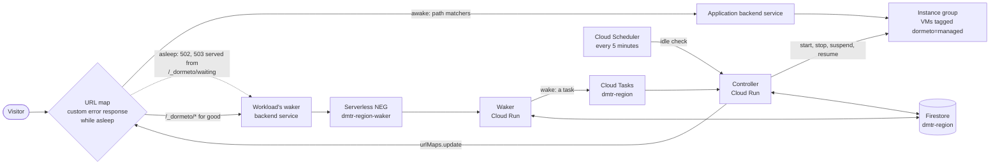
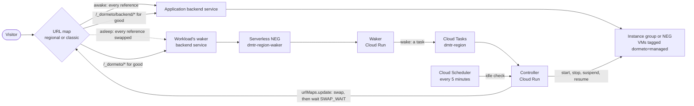

# Google Cloud: Compute Engine VMs

Compute Engine VMs in unmanaged instance groups, managed instance groups (zonal or regional) or zonal network endpoint
groups, behind a backend service of an **Application Load Balancer**: external global (`EXTERNAL_MANAGED`), regional
(`EXTERNAL_MANAGED`, in the router's region) or classic (`EXTERNAL`), or [internal](#internal-load-balancers) (`INTERNAL_MANAGED`). The nap suspends or stops them, the wake starts or
resumes the ones it napped. The router runs in your project as two Cloud Run services, and `dormeto gcp install` puts it
there: router 0.34.0 for groups behind the global load balancer; from router 0.37.0, [zonal network endpoint
groups](#zonal-network-endpoint-groups), [the regional and classic load balancers](#regional-and-classic-load-balancers-the-swap),
[schedules and pauses](#schedules-and-pauses) and [IP lists](#ip-lists). The router also has AWS's [settings by
level](#settings-and-their-levels), the wake mode and the rules, [the branded waiting page](#the-waiting-page), [a capacity
retry with fallback machine types](#capacity-and-fallback-machine-types) and [the internal load
balancers](#internal-load-balancers). These were accepted in `dormeto-dev` on 2026-11-08 and 2026-11-09, on dev builds of `main` (router 0.39.0-dev.2, then 0.39.0-dev.3 with the final review's fixes). Accepted there: the settings by level, the wake mode and rules, the waiting page, the fallback's machine type change
through the router's own role, both internal kinds (measured, napped by the idle check, woken by the page's probe) and GKE's
refusal. Not released yet: router 0.40.0, which holds them.

The global load balancer keeps the application's backend service in its URL map and serves the waiting page through a
custom error response (the diagram, and [Behavior](#behavior)). The regional and classic ones have no custom error
response, so the router swaps the URL map's references to the application at each nap and wake (their section). Cloud
SQL instances nap with a workload as its companions ([Google Cloud: Cloud SQL databases](google-cloud-sql.md)), and GKE
pods behind standalone network endpoint groups have their own page ([Google Cloud: Kubernetes on
GKE](google-kubernetes-engine.md)).



## Services

- **Cloud Load Balancing:** the URL map, the application's backend service and, per workload, a backend service
  `dmtr-<region>-<workload>` on the router's serverless NEG `dmtr-<region>-waker`, with the custom request header
  `x-dormeto-workload: <workload>` (and `x-dormeto-switch: swap` on a classic load balancer; a regional waker backend
  service has none, its URL map carries them: [the swap](#regional-and-classic-load-balancers-the-swap)).
- **Compute Engine:** the VMs, their groups and autoscalers, and the zonal network endpoint groups naming VMs.
- **Cloud Run:** the waker `dmtr-<region>-waker` (ingress internal and Cloud Load Balancing, no invoker check, 0 to 10
  instances, 80 concurrent requests, 256 MiB, or 512 MiB once an IP list is set, timeout 120 s) and the controller
  `dmtr-<region>-controller` (invoker check on, at most 10 instances, 10 concurrent requests, 512 MiB, timeout 1800 s).
  Both get CPU during requests only, so an idle instance costs nothing. One container image, `DMT_ROLE` picks the role.
- **Firestore, Cloud Tasks, Cloud Scheduler, Cloud Monitoring:** the router's state (database `dmtr-<region>`), its
  asynchronous actions (queue `dmtr-<region>`: 3 attempts, 5 to 60 s apart), the check every 5 minutes (job
  `dmtr-<region>-check`) and the request counts.

The router runs as the service account `dmtr-<region>@<project>.iam.gserviceaccount.com`, whose custom roles
`dormetoRouter` and `dormetoRouterBackends` are in `gcp/access.json`, permission by permission. The router cannot
change IAM. The VMs start, stop, suspend and resume only with the tag `dormeto=managed` (a secure tag the onboarding
binds to the workload's VMs and groups).

## Wake time

**About 15–20 s after a resume, 43 s after a start** for a VM, **28 s after a resume, 40–43 s after a start** for a
managed group of two: from the wake request to the workload awake, through the router, with a small web server on `e2`
VMs and a health check every 5 s with 2 healthy checks.

| Measured through the router (2026-10-30, 6 runs) | Wake request to `AWAKE` | Browser: page opened to application shown |
|---|---|---|
| VM, resume | 14.8 s, 19.8 s | 16.8 s |
| VM, start | 42.6 s | |
| Managed group of two, resume | 28.2 s | 31.8 s |
| Managed group of two, start | 40.3 s, 43.1 s | 44.7 s |

Compute Engine's own times, measured through the load balancer before the router existed, five runs each: 13–25 s after
a resume and 37–41 s after a start for a VM, 28–34 s and 37–43 s for the group. So the router adds no delay that these runs
can tell apart, and the page's probe every 3 s adds at most 3 s. At a health check of 1 s, Compute Engine's times were 13 s
after a resume and 30–39 s after a start: set the health check to 1 s for the fastest wakes.

A waker with no instance running starts in about a second: the first page took 1.7 s, the others about 30 ms.

These times are the global load balancer's, with instance groups. Zonal network endpoint groups and the regional and
classic load balancers have their times in their own sections below.

## Behavior

This section is the global load balancer's. The regional and classic ones change the URL map instead: [the
swap](#regional-and-classic-load-balancers-the-swap).

**There is no switch at the wake.** A URL map change takes 3 to 3.5 minutes to reach every request on the global load
balancer (measured), far beyond what a request can wait. So the application's backend service stays in the URL map for
good, and the nap uses the load balancer's **custom error response** instead.

**Nap.**
1. In each path matcher of the URL map that names the application's backend service (a map's default service gets a
   matcher `dormeto-default` of its own at the onboarding: a policy on the map itself would cover the whole load
   balancer), the router writes a custom error response policy: the load balancer's `502` and `503`, which it answers
   when no backend is healthy, are served from the workload's waker backend service at `/_dormeto/waiting`, with the
   status overridden to `503`. One `urlMaps.update` each, with the map's fingerprint; refused because of another update
   of the map, it is read again and retried with a pause, up to 60 s. A service that no URL map names any more, or that
   another URL map names too, is not napped: the workload stays awake, nothing is stopped, and the log says why.
2. It waits 300 s for the change to reach the load balancer (measured: 163–215 s). The application serves during that
   wait: it is the drain. A whole nap takes 6.5 to 8 minutes (measured).
3. It stops the VMs, or suspends them when the `hibernate` setting is on and the VM can be suspended (no GPU, no TPU,
   not confidential, at most 208 GB of memory; a refused suspension falls back to a stop). A managed group is napped
   through the group (`stopInstances`, `suspendInstances`), which keeps the VMs as a standby pool: none is re-created
   (but see the 60 days in the limits).
   Its autoscaler, if any, is turned off for the nap.

**While asleep.** Every request gets the waiting page (a `503` with `Retry-After`), served by the waker: the waker
answers the load balancer's fetch with a `200`, and the policy's override gives the visitor the `503`. The page's script
probes `/_dormeto/wake`, a route the onboarding added to the URL map for good, which goes through the same request
filters as on AWS (bots, scanners, no-wake rules) before it wakes the workload. API clients wake it with
`POST /_dormeto/wake`, answered with a `202`, JSON and the headers `x-dormeto-state` and `Retry-After` (a `200` once
awake): the waker answers no `503` there, which the policy would replace with the page. A plain request does not wake: the wake mode is `browser` here, fixed
([Settings](#settings-and-their-levels)), as the error response's fetch may not carry the visitor's request, and
waking on it would let every scanner wake the workload. The page reloads the visitor's address once the workload is
awake.

What the error response's fetch carries (measured): always a `GET` of `/_dormeto/waiting`, whatever the visitor's method and
path, with the visitor's query string and address, and these headers (measured on 2026-11-08; `referer` in an earlier
measure): `accept`, `accept-language`, `cookie`, `forwarded`, `host`, `referer`, `traceparent`, `user-agent`, `via`,
`x-cloud-trace-context`, `x-dormeto-workload`, `x-forwarded-for` and `x-forwarded-proto`. So the waker could read who asks but
not what for, which is why a plain request still does not wake. A wake rule on what the fetch does carry (the user agent, the
address, a header such as a cookie) wakes.

**Wake.**
1. The waker asks the controller for the wake through a task. The first request wins, as on AWS.
2. The controller starts or resumes the VMs (a managed group: `startInstances`, `resumeInstances`, then the autoscaler
   gets its mode back), and polls the backend service's health every 2 s.
3. At the first healthy instance the workload is `AWAKE`, and the error response policy is removed from the URL map.
   Until it is, the load balancer already sends requests to the VMs as soon as they are healthy: nothing needs to
   propagate. After it, the application's own `502` and `503` are its own again.

A wake that gets no healthy instance within the wake timeout (600 s by default) fails and says why, as on AWS; a start
refused for lack of capacity (`ZONE_RESOURCE_POOL_EXHAUSTED`) is a capacity failure, tried again within the wake, and a VM
may fall back to another machine type ([capacity](#capacity-and-fallback-machine-types)).

**Idle check (every 5 minutes).** For each awake workload, the router reads the application's backend service's
`request_count` over the idle window, through any URL map. The metric's delay is 210 s: Google documents the newest
requests as not visible for up to that long. So the check reads that much further back, and the effective idle window
is that much longer. None: nap. A nap that the check asked reads the traffic again before it stops anything, from the
check's request less 210 s to that moment. A request in it gives the nap up (`traffic`), and the workload stays awake.
The last 210 s stay unseen even then, as the metric lags. A read that fails gives the nap up too (`traffic-unread`). For each workload asleep, it checks the URL map still holds
the error response policy and the `/_dormeto/*` route (else it repairs them), and that the VMs are still down: a VM
started by hand makes the workload awake, and VMs all stopped by hand while it is awake make it `ASLEEP` with the cause
`external-stop`, as on AWS. A wake asked during a nap is kept: during the wait the nap gives up, no VM is stopped and the policy is removed; once the
VMs are going down, the workload wakes as soon as the nap ends.

**A wake or a nap that dies.** A wake or a nap runs in one request of the controller. A running wake or nap beats on its
run every minute (`beatAt`, in `dormeto gcp workloads show --json`), and a beat that fails is tried again once, 10 s
later. One whose beat is older than 3 minutes, or absent 90 s after it was asked, is stale: its task was lost or its
request died. The check, and the waker when a visitor polls, act on it at most once a minute. A stale wake is sent again
with its `wakeId`, twice at most, which a duplicate cannot disturb: after that, its deadline alone acts. A stale nap is
called stuck: the workload is then `FAILED`, and the next wake works. So both are sent again or called stuck within
minutes. The deadlines stay as the last resort, for a run from before the beat or one that beats on: the wake's timeout,
and for a nap called stuck after 35 minutes, or 22 under a swap with no VM stopping yet
([the swap's limits](#limits-of-the-swap)). Until then a visitor's wake waits for the nap.

**A nap that gives up.** Before it stops anything, a nap checks that nothing changed since the onboarding, and gives up
otherwise: nothing is stopped and the workload stays awake. The run says why, until a nap commits: `dormeto gcp
workloads show` prints it in a `nap given up:` line (its reason and time), and `--json` carries it as `napAborted`
(`reason` and `at`). The reasons: `backends-changed`, `traffic`, `map-busy`,
`switch-failed`, `paused`, `pending-wake`, `traffic-unread` and `swap-lost` or `policy-lost`. `backends-changed` checks, against the onboarding, an
unmanaged group's VMs (added or removed), a network endpoint group's endpoints, and the backend service's backends
(added or removed); a group or service that is gone counts as changed. After such a change, offboard and onboard the
workload again. A config written before the checks compares nothing for the groups and the service.

**Stats.** The router counts, per workload and day, the wakes by trigger and the requests it ignored or deferred. It
commits a count at most every 10 s per document and flushes what is left when Cloud Run stops the instance (`SIGTERM`).
The counts are kept 35 days and swept once a day, and an offboarding deletes its workload's.

**Request logs.** The idle check can read the load balancer's request logs instead of counting every request.
- **What it reads.** On a backend service that logs every request (`logConfig` enabled, sample rate 1.0), any entry in
  the window's request logs makes them decide alone, whatever Monitoring counts. The check reads the log entries from a
  minute before the window to its end: the extra minute can only add requests. It counts only the requests the waker
  would not ignore: not scanners, not `HEAD` requests, not an IP list's addresses, not what a no-wake rule of any level
  matches. A logged request holds its method, path, user agent and address, and its only headers are `user-agent` and
  `x-forwarded-for` (the address): a rule's `headers` condition on either can match it, and one on any other header never
  does, so the request counts. If none is left, the workload is idle. With logs that cannot
  be read or hold more than 1,000 entries, or with logging off or sampled, Monitoring's count decides.
  An empty log while Monitoring counts requests leaves the count deciding: a log lost upstream (a `_Default` sink's
  exclusion of the load balancers' logs, say) is caught that way, said in `LogsEmpty` at most once an hour per workload
  and controller instance. A log lost only in part is not caught: an exclusion that keeps part of the load balancers'
  logs, one added during the window, or a long ingestion delay leaves entries, and the logs decide on what is left.
  `workloads show` says which it read: `idle check: request logs` or `idle check: request count`.
- **Why the logs alone.** Monitoring's `request_count` is sampled and batched: its one-minute points came late and in
  lumps (13 for minutes that logged 4), with gaps of six minutes (measured on 2026-11-08). It cannot tell whether the
  logs are complete, so they are not compared with it, but for an empty log.
- **The newest requests.** An entry reaches the logs after its request: 0.6 to 1.5 s later on a classic load balancer,
  about 10 s on a regional one (measured). A request the check could not see yet is read by an idle nap's last read,
  before anything stops.
- **Scanners that send a browser's user agent to the application's own paths count as activity** (`/`,
  `/favicon.ico`, `/geoserver/web/`, seen within minutes on a bare address): the waker's filters cannot tell them from
  visitors, and they keep the workload awake. IP lists catch known scanner networks ([IP lists](#ip-lists)).
- **How it gets there.** `dormeto gcp install` creates the log view `dmtr-<region>-lb` on the project's `_Default`
  bucket, filtered to the load balancers' request logs, and gives the router `roles/logging.viewAccessor` on that view
  alone, by an IAM condition: never the project's other logs. `dormeto gcp workloads onboard --request-logs` turns the
  backend service's logging on at sample rate 1.0, as the operator; the offboarding sets it back. Without the flag, the
  onboarding warns that every request counts, scanners included. On a regional load balancer, logging begins a few
  minutes after the change (2 to 5 minutes, measured): a request in those minutes is not in the logs. So the count
  decides while the window's logs are empty, and once they hold an entry, the first idle window after the onboarding
  does not see that request.
- **Terraform.** If you write the backend service in Terraform, keep this block in it. Then an apply does not turn the
  logs off.

  ```hcl
  log_config {
    enable      = true
    sample_rate = 1.0
  }
  ```

- **Cost.** Cloud Logging charges past 50 GiB a month and project, about 1 KB per request: 50 million requests are free.
- **Limit.** The view lives in the `global` location. A project whose `_Default` log bucket isn't in `global` gets no
  log view: the install says so and goes on, and the idle check counts every request.

**Offboarding.** `DELETE /v1/workloads/<id>` (the CLI) removes the policy, the route and the waker backend service. With
`force=true` it does so for a workload that cannot wake, and leaves its VMs down, saying so.

## Zonal network endpoint groups

**From router 0.37.0, accepted on 2026-11-04** with CLI 0.11.0: a NEG's VM, with a Cloud SQL companion,
napped by its idle window and woken by a browser through the router. The VMs' own times below were measured on Google
(2026-10-31).

A backend of the application's backend service may be a zonal network endpoint group (NEG) of type `GCE_VM_IP_PORT`,
each endpoint naming a VM. The onboarding reads the endpoints, and their VMs are napped as an unmanaged group's are:
tagged `dormeto=managed` by the CLI, stopped or suspended, then started or resumed, with the same rules for suspending.
A stopped or suspended VM keeps its endpoint (measured), and the custom error response catches the `503` of a NEG whose
VMs are down as it does for a group: the waiting page came about 2 s after the stop. On a regional or classic load
balancer the swap applies to them as to a group's VMs.

**A nap acts only on what still is the NEG.** Each VM's record names its NEG. The nap reads the NEGs' endpoints before it
writes anything, and again just before it stops a VM: a VM added or removed, an endpoint naming no VM, or a NEG deleted
since the onboarding gives the nap up (cause `backends-changed`, said in the log), nothing stopped, the workload awake.
Every later nap gives up the same way until the workload is offboarded and onboarded again. A wake starts what was
recorded.

| Measured with the measuring tool (2026-10-31), a VM in a zonal NEG | Stop or suspend | Start or resume |
|---|---|---|
| Stopped VM, 5 runs each way | no instance healthy after 9–11 s, stopped after 106–107 s | running after 8–39 s, healthy after 33–64 s, the application answering steadily after 38–75 s |
| Suspended VM, 3 runs | no instance healthy after 25–27 s, suspended after 26–51 s | healthy after 11–13 s, the application answering steadily after 13–18 s |

These are Compute Engine's times through the load balancer, before the router's code; one request of the first run hung
for its 6 s right after the stop, as with groups. Through the router, the acceptance's NEG workload had a Cloud SQL
companion: its nap took 8.5 minutes (the policy's 300 s, the VM suspended, then the database), and a browser's probe
woke it in 551 s, the database's start, then the VM's ([Cloud SQL's wake time](google-cloud-sql.md#wake-time)). A NEG's
VM without a companion was not timed through the router.

### Limits of zonal NEGs

- **Refused at the onboarding, each with what to change:** a NEG of another type (serverless, internet, private service
  connect, `NON_GCP_PRIVATE_IP_PORT`), a NEG with no endpoint, an endpoint that names no VM, a VM of a managed group (a
  stopped VM is the group's to repair: put the managed group in the backend service instead of its VM in a NEG), and a
  NEG GKE made, whose endpoints are pods, unless it is onboarded as pods ([Kubernetes on
  GKE](google-kubernetes-engine.md)).
- **A VM added to or removed from a NEG while the workload sleeps is found at its next nap,** which gives up: the wake
  starts only the VMs recorded. After changing a NEG's endpoints, offboard and onboard the workload again; until then it
  stays awake, and only the log says why.
- **The router's permission:** `compute.networkEndpointGroups.get`, which `listNetworkEndpoints` asks too.
- **Terraform.** A nap changes no endpoint (a stopped VM keeps its own), so a NEG's endpoints need no `ignore_changes`;
  its VMs need what any VM needs ([Limits](#limits)).

## Regional and classic load balancers: the swap

**From router 0.37.0, accepted on 2026-11-04** with CLI 0.11.0, and for ten workloads on one URL map
on 2026-11-08 ([the swap's limits](#limits-of-the-swap)). Each kind was onboarded, napped, woken and offboarded
through the router, and steady traffic kept each awake; the URL maps' changes were measured beforehand (2026-10-31).

A regional or classic external Application Load Balancer has no custom error response: Google refuses the policy on both.
So the router changes the URL map itself, one `update` at each nap and one at each wake: every reference to the
application's backend service (the map's default, a path matcher's default, path rules, route rules, weighted services)
becomes the workload's waker backend service, and back. A map's change reaches the load balancer slowly, so each one is
followed by a wait, SWAP_WAIT: 100 s on a regional load balancer, 250 s on a classic one, 30 s on an internal one and 150 s on a cross-region internal one (measured: the last old answer
up to 89 s after a regional change; a classic change settled up to 226 s after its update). Google retires the classic
load balancer and offers a migration to the global one, whose wake does not wait for a map's change: prefer it.



### Onboarding

- **The kind is read from Google:** the URL map is looked for globally and in the router's region, and its forwarding
  rules' scheme tells a global load balancer from a classic one. `dormeto gcp workloads onboard --load-balancer
  global|regional|classic` says it when the same name exists in both, which is refused otherwise. A regional load
  balancer of another region is refused: onboard it on that region's router. A map with forwarding rules of both a
  global and a classic load balancer (a migration under way) is refused until the migration ends. A classic load
  balancer on the Standard network tier has a regional forwarding rule that targets a global proxy. The onboarding finds
  it through the aggregated forwarding rules, and the kind is read as classic. Google accepts such a load balancer for
  the swap (measured on 2026-11-08, at classic's times: [the swap's wake time](#wake-time-of-the-swap)).
- **The waker backend service follows the kind:** regional in the router's region (`regionBackendServices`), or global
  with the scheme `EXTERNAL` on a classic load balancer, both on the router's serverless NEG.
- **The hold route.** Google does not health check a backend service that no forwarding rule reaches, and a wake waits
  for a healthy instance. So the onboarding adds for good, beside `/_dormeto/*`, the route `/_dormeto/backend/*` to the
  application's backend service: it keeps the service in the map through a swap, health checked (measured: healthy 35 s
  on classic and 40 s on regional after a start, 9 s and 14 s after a resume). A request there reaches the application,
  or Google's `503` while it sleeps, and the application sees that path. With route rules, the hold route takes priority
  0 and the waker's route priority 1: both must be free.
- **A regional waker's headers are in the map.** Google refuses custom request headers on a regional backend service
  (measured: a `400` at the insert). So a regional waker backend service has none, and its description says whose waker
  it is (`Dormeto: the waker of workload <id>`), which a later onboarding of the same workload reads. Wherever the regional
  map names the waker, it names it as a one-entry weighted service (`weight: 100`) whose header action adds
  `x-dormeto-workload` and `x-dormeto-switch: swap` with `replace: true`, which replaces a client's own value: on the
  `/_dormeto/*` route, and at a swap in place of each reference. A plain reference (`defaultService`, `service`) gets a
  third header, `x-dormeto-ref: service`, so that the unswap writes the plain reference back; a weighted reference of
  yours keeps its weight and its own header action, Dormeto's headers added to it and taken out again. On global and
  classic load balancers the waker backend service carries its headers itself. On each kind a client's own
  `x-dormeto-workload` or `x-dormeto-switch` never won (measured).
- **Refused:** a map whose `tests` or `requestMirrorPolicy` name the application (Google validates the tests at each
  update, and a swap would fail them, or leave a mirror), and a weighted route sending to the application and to other
  services (a swap would change their shares).

### Nap, sleep and wake

**Nap.**
1. The NEGs' endpoints are read: unchanged, or nothing is written ([zonal NEGs](#zonal-network-endpoint-groups)).
2. The swap is written. Visitors reach the waiting page as it spreads.
3. The router waits SWAP_WAIT: the application's drain and the change's spread.
4. The swap is written again, to be sure: a check's repair or a Terraform apply may have taken it away meanwhile.
5. The endpoints are read again, then the VMs stopped or suspended.

Measured through the router: on classic, a nap in 5.5 minutes (the swap, 250 s, then the VM suspended after another
minute); on regional, the waiting page reached visitors 53 s after the nap began, and the workload was `ASLEEP` 3.5
minutes after it began (100 s, then the VM suspended).

**While asleep.** The waker gets the visitor's real request, its method, path and body, with no policy to change its
answer: a `200` would tell an API client it succeeded. So under a swap the waker answers the waiting page as a `503` with
`Retry-After`, whatever the method, and a request with a body gets the page too, unlike on the global load balancer. In the wake
mode `any`, the default under a swap, a plain request the filters let through wakes the workload too and gets the page at
once, as on AWS; in `browser`, only the page's probe of `/_dormeto/wake`, `POST /_dormeto/wake` or a wake rule does
([the wake mode](#settings-and-their-levels)). The load balancer does not retry the waker's `503` (measured: one waker request per visitor's request).
The waker knows it is behind a swap from the header `x-dormeto-switch: swap`, so it answers rightly even when Firestore
cannot be read.

**Wake.**
1. The controller starts or resumes the VMs.
2. It waits for one healthy instance, which the hold route makes possible.
3. It unswaps the map.
4. It waits SWAP_WAIT, then the workload is `AWAKE`, so that the page's reload lands on the application.

The map's change is part of the wake's time. The built-in wake timeout is 600 s, whatever the load balancer; behind a swap it
can't be less than SWAP_WAIT plus 60 s ([the fixed values](#settings-and-their-levels)). A VM that cannot start while another one is healthy does not keep visitors at the
waker: `BackendsNotWoken` is logged, the map is unswapped and the workload is `AWAKE`.

**A nap given up** (a wake asked during it, a pause, a changed NEG, a map Google refuses): the router unswaps the map,
waits SWAP_WAIT, then the workload is `AWAKE`; with nothing swapped yet, there is no wait. Visitors stay at the waker
until the unswap has spread.

**The check.** Every 5 minutes the map is put back as the state says: a swap written by hand on an awake classic
workload was repaired at the next check, 43 s later, and a regional map's `/_dormeto/*` route deleted by hand came back
at the next check (measured, logged `RouteDrift`). VMs started by hand while the workload sleeps
make it awake through a wake, which unswaps and waits (`external-start`).

**Idle signal.** Classic: `loadbalancing.googleapis.com/https/request_count`, resource `https_lb_rule`, as on the
global load balancer. Regional: `loadbalancing.googleapis.com/https/external/regional/request_count`, resource
`http_external_regional_lb_rule`, with the region in the filter. Both by the backend service's plain name, read back
with real traffic (measured); the first point came 84 s (classic) and 51 s (regional) after the requests. Steady
traffic, 45 requests in 15 minutes, kept each kind awake through the router with a 5-minute idle window (the
acceptance).

**Offboarding** puts the application back wherever the map is still swapped and removes the hold route and the
waker's route, in one update, then deletes the waker backend service. Measured: a classic offboarding in 1 min 42 s, the
map back as before its onboarding.

### Wake time of the swap

| Measured through the router (2026-11-04, a suspended VM) | Nap | Wake to the application answering steadily |
|---|---|---|
| Classic | 5.5 minutes | 2 min 16 s after a visitor's `POST /_dormeto/wake`; `AWAKE` after 287 s, the unswap's 250 s included |
| Regional | 3.5 to 6.5 minutes to `ASLEEP` | 62 s after a `POST /_dormeto/wake`; `AWAKE` 123 to 188 s after a wake by a browser's probe, a `POST` or a pause, the unswap's 100 s included |

On the Standard network tier (2026-11-08), the nap's task took 316 s, an operator's nap 325 s to `ASLEEP`, and a
`POST /_dormeto/wake` woke the workload to `AWAKE` in 289 s and 297 s, the unswap's 250 s included: classic's times on
the Premium tier (287 s above).

The maps' own changes, measured before the router's code: a classic map's update took about 17 s, then the first new
answer came after 38–123 s, the last old one after 76–221 s, settled after 78–226 s, with 3 to 11 answers `502` at the
change (5 runs). A regional map settled 35 s after its update's end, but the update itself took 85 s (6 to 26 s in
earlier runs), with one answer `503`.

### Limits of the swap

- **Set a wake timeout that leaves room for the map's change.** A wake timeout of SWAP_WAIT plus 60 s or less (160 s
  regional, 310 s classic, 90 s internal, 210 s cross-region internal) is refused, at the onboarding and at the settings, as a wake would always fail, and an inherited
  one is brought above it; about 250 s or more on a regional load balancer and 340 s or more on a classic one is advised.
- **Classic's redirect on an HTTP-only front end.** Right after a classic map's change first sends a path to the waker
  (the onboarding's route, a nap's swap), Cloud Run answered that load balancer's plain-HTTP requests with a 302 to
  `https://` for about 40 s (measured: 20 answers in 37 s, then none). Behind an HTTPS front end it is harmless; on an
  HTTP-only one, visitors get that redirect, an error, for that moment. Serve a classic load balancer over HTTPS, or
  migrate it to the global one. The global load balancer over HTTP showed none.
- **A visitor at a nap's start waits up to 2 × SWAP_WAIT with the VMs running.** A visitor who reaches the waiting page
  while a nap waits for its swap wakes the workload, but the nap gives up only at the end of its wait, then unswaps and
  waits again: up to 200 s on regional and 500 s on classic on the waiting page, though no VM stopped. A longer idle
  window makes it rarer.
- **A nap that dies under a swap holds visitors for minutes.** If the nap's request ends while the map is swapped and no
  VM is stopping yet (a new revision of the controller, for example), visitors get the waiting page. The nap stops
  beating, and the check calls it stuck within minutes; the workload is then `FAILED`, and the check's wake brings it
  back. A nap from before the beat, or one that beats on, is called stuck after 22 minutes under a swap. Once a VM is
  stopping, it is 35 minutes. The acceptance of 2026-11-08 ran a regional nap through an upgrade to a new revision. Cloud Run let the in-flight request
  finish on the old revision, and the workload slept 165 s after the nap was asked. A nap that does die is caught by its
  heartbeat.
- **A request with a body gets the page under a swap**, a `503`, for any method: API clients should read a `503` as
  asleep, send `POST /_dormeto/wake`, then retry their request.
- **Ten naps on one regional URL map.** A regional map's update took 85 s (measured). The naps of one map no longer fail
  on it: those in the same controller instance wait for the update under way and share the next. A nap retries a map that other updates keep busy (your Terraform's, say) for about 120 s.
  Then it gives up as `map-busy`, the workload left awake with its idle time kept. It is no failure, and the next check asks
  again. Ten naps asked at once on one map were all asleep, none failed, within 509 s global and 283 s regional (the
  acceptance of 2026-11-08). Give workloads of one regional map different nap windows if their naps give up.
- **At most 20 naps in flight per router (`NapDeferred`).** A nap holds a controller request for minutes. So a check asks
  for at most 20 naps at once, counting the naps already running. It asks the scheduled ones first. The others are said once
  in the log (`NapDeferred`, with their count) and nap at a later check.
- **A header of your own named `x-dormeto-*` on a regional map's swapped entry is replaced at the swap and not given
  back** at the unswap: the `x-dormeto-` headers are Dormeto's. Name your own headers otherwise.
- **Your routes under `/_dormeto/`.** `/_dormeto/*` and `/_dormeto/backend/*` are Dormeto's: a route of your own under
  `/_dormeto/` makes the workload ineligible.
- **One router per region.** A regional load balancer is onboarded on the router of its region.
- **Terraform.** A regional (`google_compute_region_url_map`) or classic (`google_compute_url_map`) URL map changes at
  each nap and wake, and holds Dormeto's routes (and, on regional, the waker's headers): ignore
  `lifecycle { ignore_changes = [default_service, default_route_action, host_rule, path_matcher] }`. Otherwise an apply
  puts the application back in a sleeping workload's map, and the visitors get Google's error until the next check
  swaps it again. The demo's regional and classic maps have it, and `terraform plan` showed no change with a regional
  workload onboarded (the acceptance; the classic one was offboarded by then).
- **Idle signal.** A metric filter that matched nothing would read 0 and nap a busy workload. The filters were read back
  with real traffic, and steady traffic kept each kind awake through the router (the acceptance: 45 requests in 15
  minutes, a 5-minute idle window).

## Settings and their levels

A workload's settings come from AWS's levels: the workload, its type, the router, the organization, then the built-in
value. The names, the values and the answers are AWS's (`idleMinutes`, `settingsFrom`, `type`, `noWakeRules`, `inherits`),
so one model describes both clouds. The CLI sets them with `dormeto gcp workloads settings` and `dormeto gcp routers settings` (the README has the
flags); the controller's routes are `PUT /v1/workloads/{id}/settings`, and `GET` and `PUT /v1/settings` for the router's level, with
AWS's bodies, answers and checks: a value that is not a whole number in its range is the problem `<key>: must be a whole number from
<min> to <max>` (an onboarding's problem starts with `settings: `), as AWS's, and the manager's `status` has `settings` of AWS's six keys, `wakeMode` beside them at the top (the REST Workload's `settings` keep seven).

- **The levels.** The workload's own values are in its configuration, which lists in `inherits` the keys that follow the levels;
  the router's are in the Firestore document `router/settings` (`hibernate`, `joinMinutes`, `defaults`, `by`, `at`). The
  organization level and the custom types are the manager's: it pushes its `settings.json` to the router (see
  [the manager page](google-cloud-manager.md)), and until it does the organization level reads as unset and only the built-in
  types exist. The router level is one per project and region, and applies to the workloads it serves.
- **The types** keep AWS's names: `instance` is a VM of an unmanaged instance group or of a zonal network endpoint group, `asg` a managed
  instance group, `k8s` GKE pods and `databases` a Cloud SQL companion (on AWS an EC2 instance, an Auto Scaling group, Kubernetes on EKS, and RDS or
  Aurora). A workload's type is read from its primary backends, databases first, unless `--type` names another.
- **The built-in values** are AWS's: an idle window of 15 minutes, a wake timeout of 600 s, a retry after a failed wake of 60 s
  and the wake mode `any`. The built-in wake timeout is 600 s for every kind, but the `databases` type's built-in is AWS's 1800 s, brought to Google Cloud's cap of 1700 s and shown `fixed`
  below: the computed 300 s for pods and the 1700 s of a Cloud SQL companion of earlier routers are gone, and the swap's wait is
  a floor, not an addition. A longer timeout only delays a failure's report.
- **A router level never read on this controller instance** takes no idle nap or release decision, waits the longest wake
  timeout (1700 s) and stops plainly, logged `SettingsLevelUnreadable`, as on AWS. A failed read of the router level keeps the last
  record this controller instance read, and the failure is logged the same way.
- **The controller resolves before it acts.** The check, the nap, the wake and the release use the resolved values
  (`idleMinutes`, `wakeTimeoutSeconds`, `failedRetrySeconds`, `hibernate`), and the waker resolves the same ones, so the two
  agree, but for up to 60 s after a change of the router level, which the waker keeps 60 s in a cache. The controller reads the
  router level from the store, once per check and once per wake, nap or release, and keeps the last record it read.
- **A configuration written before the levels** has no `inherits`: an `idleMinutes` of 15 and a `failedRetrySeconds` of 60 are
  read as inherited, its wake timeout stays its own, and nothing is rewritten. A new onboarding writes `inherits` for every
  key it is not given.

### What Google Cloud fixes

Some values can't be chosen on Google Cloud. The router resolves them to the value Google imposes. The origin is `fixed` in
`settingsFrom`:

| Key | On Google Cloud | Why |
|---|---|---|
| `waitSeconds` | 0 | The waker holds no request: it answers the waiting page at once, and the page waits for the wake. |
| `maxHolders` | 0 | No request is held. |
| `drainSeconds` | 0 | The nap's switch is a URL map change, and the backend service's own connection draining applies. |
| `wakeMode` | `browser` behind the global load balancer's policy | The error fetch carries neither the visitor's path nor its method: waking on it would let every scanner wake the workload. |
| `wakeTimeoutSeconds` | at most 1700 | One controller request lasts at most 1800 s. |
| `wakeTimeoutSeconds` | more than the swap's wait + 60 s behind a swap | The wake waits for the map's change to spread: more than 160 s on a regional load balancer, more than 310 s on a classic one, more than 90 s on an internal one, more than 210 s on a cross-region internal one. |

An explicit workload value outside these bounds is refused; an inherited one is brought into them and shown with the origin
`fixed`, so a router's value never makes a workload unwakeable. The refusals say the reason, and `inherit` is accepted for the three zeros.
`wakeMode: any` on a workload behind the global load balancer is refused: `the global load balancer's waiting page can't see the
visitor's request, so only the page's probe, an explicit wake or a wake rule wakes it (wake mode browser)`. At the router's level, `any`
is accepted: it applies to the workloads behind a swap, and a workload behind the global load balancer is brought to `browser`.

### The wake mode, by load balancer

- **Behind the global load balancer's policy** the wake mode is `browser`, fixed: the waker receives only the error fetch, a `GET` of
  `/_dormeto/waiting` with no path and no method of the visitor's. Only the page's probe, an explicit wake (`POST /_dormeto/wake`, or
  the wake header `x-dormeto-wake: 1`) or a wake rule wakes it, and any other request that the filters let through is deferred;
  scanners' requests count as `deferred:browser mode`. A visitor on a `.php` URL or on a path a no-wake rule keeps gets a page
  whose probe never wakes the workload, as on AWS: the probe is decided on the visitor's path.
- **Behind a swap** (regional, classic and the internal kinds) the default wake mode is `any`: a request the filters let through
  wakes the workload and is answered with the waiting page at once, with no hold. In `browser`, only the page's probe, an
  explicit wake or a wake rule wakes it, as G1's waker did for every workload: set `browser` at the router or the workload to keep
  that. `/_dormeto/backend/*` goes to the application and never comes here.
- **The wake header and the probe header.** The wake header `x-dormeto-wake: 1` and the probe header wake under a swap and on the
  policy's fetch, as on AWS. Google's error fetch passes a visitor's header of its own (measured on 2026-11-09: a browser's
  `GET /` with `x-dormeto-wake: 1` to the global load balancer woke an asleep workload, trigger `header`); the headers it
  carries are in [Behavior](#behavior).
- **A decision that fails** is logged `WakeDecisionFailed` and the page is answered all the same: a visitor never gets an error
  for it.

### The rules, and what each request lets them see

The no-wake rules and the wake rules are AWS's, in the same shape and with the same checks. At most 20 rules per list and level,
which add up across the levels, the most general first; the first match decides, and a level's list replaces that level's list as a
whole. The order is the shared `classify`'s: the no-wake rules, then `HEAD`, bots and scanner paths, the wake header, the wake
rules, the IP lists, the probe and the wake mode. What a condition sees depends on the request the waker gets:

| The request | `sourceIps` | `userAgentPattern`, `headers` | `pathPrefixes`, `pathPattern` |
|---|---|---|---|
| A visitor's request behind a swap | the client's address | the request's own | the visitor's path |
| The page's probe | the client's address | the browser's request | the visitor's path, sent by the page in `x-dormeto-path` from `location.pathname` |
| The policy's error fetch | the client's address | the headers the fetch carries, `accept-language`, `cookie`, `referer` and `user-agent` among them ([measured](#behavior)) | none: a path condition never matches |
| An explicit `POST /_dormeto/wake` | the client's address | the request's own | `/_dormeto/wake` |

The client's address is read as [the IP lists](#limits-of-ip-lists) read it. The page's script sends `x-dormeto-path` only on
Google Cloud, where it is given a probe URL. A forged `x-dormeto-path` bypasses nothing a client couldn't bypass by requesting another
path. The router level holds the router-wide rules: there is no Terraform level on Google Cloud. `dormeto gcp workloads show` lists
every rule with its level.

## The waiting page

The page is AWS's branded one: a template (`icon`, `title`, `description`) or a custom HTML page, per level, the workload's and the
router's (the organization's is the manager's, pushed to the router). The most specific level with a page decides the mode, and a template
takes each field from the most specific template that has it. The limits are AWS's: an icon of 64 KiB at most, a title of 80
characters, a description of 500, HTML of 256 KiB.

- **Where it is kept.** The Firestore documents `router/page` and `pages/<id>`, each with `mode`, `icon`, `title`, `description`, `html`, `by` and `at`;
  `favicons/<id>`, with `icon`, `fetchedAt` and `error`; and the run's `recentWakes`, the durations of the last 10 wakes, written at
  each transition to `AWAKE`. An offboarding deletes `pages/<id>` and `favicons/<id>`.
- **The routes** are `GET`, `PUT` and `DELETE /v1/workloads/{id}/waiting-page` and `GET`, `PUT` and `DELETE /v1/waiting-page`. The answers have AWS's
  shape: `own`, `inherited`, `effective`, `from`, `favicon`, `warnings`, `terraform`, `by` and `at`, or a 400 with `problems`. A put needs `by`, who sets the page.
  `WaitingPageSet` records the size and the SHA-256 of a page, never its content.
- **Custom pages are off unless the install turns them on.** Custom HTML runs on the application's address. On AWS only an
  administrator may set it; on Google Cloud anyone who can invoke the controller is an operator. So `dormeto gcp install
  --custom-pages` sets `DMT_CUSTOM_PAGES=1` on the controller and the waker, and `customPages` in the install record. Without it, a
  custom page is refused, `custom pages are off on this router: an administrator turns them on with dormeto gcp install
  --custom-pages`, and a custom page already stored is read as absent: the template levels or the default page show. It stays stored,
  listed as `off`, until it is cleared or the switch comes back, so turning the switch off stops customer HTML at once.
- **The waker renders** through a cache of 60 s, 1 s per read, which keeps the last value when a read fails, with the language from
  `Accept-Language`, English or French, with `vary: accept-language`, and our `Content-Security-Policy` on a template page, never on a
  custom one. While the workload wakes, the page and `/_dormeto/wake` carry the headers `x-dormeto-wake-elapsed` and
  `x-dormeto-wake-typical`, and the progress bar is filled from the median of the last 10 wakes. A failed workload's page, and a
  backoff's (asleep with its failure), carry `x-dormeto-failure`, why it failed, and `x-dormeto-retry-at`, the next attempt as an ISO
  date, as AWS's do. The page's probe goes to `/_dormeto/wake` and sends the visitor's path in `x-dormeto-path`; a workload that sleeps
  or wakes answers a `202` there, where AWS's page answers a `503` to the probe of its own address.
- **The favicon.** The favicon is read at a nap, at most once a day, in 3 s, when the icon is `auto` and the workload awake. It
  is read from the first host rule whose path matcher sends the whole of `/` to the workload's backend
  service by the path alone. A host whose `/` goes elsewhere or depends on more than the path (a regex or a path template match, a
  header), or a wildcard host, gives no favicon: `no rule for the whole of a host name`, kept in `favicons/<id>`. The internal kinds get none.
- **Measured on 2026-11-08** behind the global load balancer: the policy's error fetch carries the visitor's `Accept-Language`
  and `Cookie`, the page's `Content-Security-Policy` and `vary: accept-language` reach the browser, and a 256 KiB custom page
  (268,112 bytes with the probe the router adds) and a template with a 59,023-byte icon arrived whole.

## Capacity and fallback machine types

As on AWS, every start and resume of a VM or a managed group refused for lack of capacity (`ZONE_RESOURCE_POOL_EXHAUSTED`,
`POOL_CAPACITY_INSUFFICIENT`) is tried again within the wake: after 30 s, 60 s, then every 120 s until the wake's deadline. Under a
swap the retries end with the room of the wake's floor left, so the last start and the map's change fit before the deadline. A quota error
is never retried this way.

`fallbackInstanceTypes`, set at the onboarding with `--fallback-type`, at most 5, for the VMs of unmanaged instance groups and zonal
network endpoint groups, gives a VM other machine types to run on:

- **At the wake.** Each VM starts on its own type first. On a capacity error the router sets the next type of its own and the list on the stopped
  VM (`instances.setMachineType`) and starts it again. Past the list the VM stays on its last type, and the retry's waits apply to it;
  its own type is tried again at the next wake. A suspended VM resumes on its own type, with the retry only: Google changes no
  machine type while a VM is suspended. A list turns hibernation off unless the workload says `true`.
- **Checked at the onboarding.** Each type exists in the VM's zone, the VM has no local SSD and no accelerator, and the type is of the
  VM's series, or both series are first or second generation ones (N1, F1, G1, N2, N2D, E2, C2, C2D, M1, M2, T2D), from Google's page on
  changing the machine type of a stopped VM; any other is refused with Google's rule. A managed group is refused,
  `fallback machine types are for VMs of unmanaged instance groups: a managed group's machine type is its template's`, and so are GKE
  pods, `fallback machine types are for VMs of unmanaged instance groups: the pods of a GKE cluster have no machine type of their own`.
  The list can't be changed after the onboarding.
- **The record.** The run's `instanceTypes` (`{<vm>: {from, to}}`), the log `InstanceTypeFallback`, and `fallbacks` in the `AWAKE`
  event; `dormeto gcp workloads show` names the type a VM runs on. The Workload view and the offboarding's answer list them in AWS's
  shape, `fallbacks: [{instance, from, to}]`, while a VM runs on one. The Firestore run is durable, so no label keeps the own type.
- **Given back at the next stop.** The nap, after the VMs stop, and the release give each VM its own type back. A failure is logged
  `InstanceTypeNotReverted`, and the run keeps the type for the next try. An offboarding while a VM runs on a fallback type names the VM, its
  type and its own, in its answer's `fallbacks`: it keeps that type until you change it by hand.
- **The permission** is `compute.instances.setMachineType`, in `dormetoRouterBackends` under its `dormeto=managed` condition, in
  `gcp/access.json`. `dormeto gcp install` adds it to an installed router. Without it, a wake that needs a fallback fails with `the router's
  role lacks compute.instances.setMachineType: run dormeto gcp install again`.
- **Not covered:** Cloud SQL tiers (Google documents no change on a stopped instance), managed groups, other zones, accelerators.

## Internal load balancers

Two kinds join the external ones, told from Google by the forwarding rules' scheme, and chosen with `--load-balancer`:

- `internal`: a regional map whose forwarding rules are `INTERNAL_MANAGED`, in the router's region;
- `cross-region-internal`: a global map whose rules are `INTERNAL_MANAGED`, onboardable on any router, as global maps are.

`INTERNAL_SELF_MANAGED` (Cloud Service Mesh) stays refused.

- **The switch is the swap.** Google documents no custom error response on either, so the switch is the swap: the router swaps the map's
  references at each nap and wake, as for a regional load balancer, with the hold route and the `/_dormeto/*` route. The waker's headers are in the map, as
  on regional: an internal backend service takes no custom request header.
- **The waker's backend service** is `INTERNAL_MANAGED`, regional for `internal` and global for `cross-region-internal`, on the router's
  serverless network endpoint group. Google accepts an `INTERNAL_MANAGED` waker backend service, regional and global, on the router's
  serverless network endpoint group (measured 2026-11-08).
- **The swap's wait.** SWAP_WAIT is 30 s on an internal load balancer and 150 s on a cross-region one. Measured on
  2026-11-08: regional internal, the other side's first answer came 0 to 3 s after the map write's operation ended (six writes, each
  5 to 7 s); cross-region internal, 28 to 120 s (nine writes, each about 40 s). The waits are ten times and one and a quarter times the
  worst. A wake timeout of 90 s or less on an internal load balancer, or 210 s or less on a cross-region one, is refused.
- **The idle check** reads `loadbalancing.googleapis.com/https/internal/request_count`, and the request logs of the resource
  `internal_http_lb_rule`, which `dormeto gcp install` adds to the log view's filter. A regional internal map's service is read with its region, a
  cross-region one's without.
- **The network.** Nothing is added: your internal load balancer has its proxy-only subnet, and the waker's ingress admits both
  internal kinds (measured 2026-11-08). The page's probe goes through the same load balancer.
- **What the waker reads.** Measured 2026-11-08: a forged `X-Forwarded-For` of `1.2.3.4` was ignored and the client's private address named,
  behind both kinds. The wake mode `any` woke on a plain request behind the cross-region kind.
- **The request logs.** Measured 2026-11-08: the resource `internal_http_lb_rule`, log `requests`, `backend_target_name` the plain name,
  `remoteIp` with a port, 2 to 4 s late on `internal` and about 7.5 s on `cross-region-internal`. The cross-region kind's entries carry the
  forwarding rule's region, its metric points `region: global`.
- **The limits.** The visitors' addresses are private, so an IP list is for private ranges. A project's regional serverless network
  endpoint groups share 5,000 queries a second (Google's documentation). A cross-region internal load balancer's waker is in one region. The page has no favicon.
  `terraform/gcp-dev` has a demo behind `enable_internal` (off by default): the proxy-only subnets, a regional and a cross-region internal load
  balancer, each in front of a small VM; the measures reach them from a Cloud Run job with Direct VPC egress.

## Schedules and pauses

**From router 0.37.0, accepted on 2026-11-04** with CLI 0.11.0, on a GKE workload, and on 2026-11-08 for ten workloads
on one URL map in one nap window. `schedule show` listed the next events; a nap window napped the
workload, and a visitor in it was told when it ends and woke nothing; an awake window woke it; a pause refused a nap and
woke a sleeper; with `--keep-asleep` the workload stayed asleep into an awake window, and a visitor's probe woke it.

As on AWS: a workload's schedule of nap and awake windows, with exceptions and `maxNapDays`, in its time zone, in the
same JSON (the CLI's README has it), and pauses with a reason. Through the controller, as the operator:

```
dormeto gcp workloads schedule show|set|clear <id> [--file schedule.json]
dormeto gcp workloads pause <id> --reason <text> [--keep-asleep] [--until <time>]
dormeto gcp workloads resume <id>
```

Each takes `--project` and `--region`. `schedule show` prints the next events; a schedule the controller refuses is
answered with what is wrong.

- **Schedules.** Each check applies every scheduled workload before its idle loop: a nap window naps the workload, an
  awake window wakes it, and a nap within 30 minutes of an awake window's start is skipped. Inside a nap window nothing
  wakes the workload on traffic, `POST /_dormeto/wake` included, unless the window's `wake` is `header` (its default is
  `never`); the waiting page tells the visitor when the window ends.
- **Joined windows.** Two windows of one kind with a short gap between them are one, as on AWS. The gap that joins is the
  schedule's own `joinMinutes`, else the router level's (`dormeto gcp routers settings --join-minutes`), else the
  organization's (the manager's `workloads.joinMinutes`, pushed to the router), else 15: the check, the waker and
  `schedule show` read it so, and `schedule show` says which (`joinFrom`).
- **Scheduled naps are spread.** A nap holds a controller request for minutes, so the check enqueues at most 10
  scheduled naps each run, oldest occurrence first, and the next check takes the rest: 30 workloads in one nap window nap
  within 15 minutes. Wakes are never held back.
- **Pauses.** A pause holds every nap (idle, scheduled, or asked with `nap`), and wakes a workload asleep, unless
  `--keep-asleep`. A nap asked before the pause is refused at its start and at its commit point. `--until` ends the pause
  at a time (RFC 3339, at most 366 days away), `resume` ends it now.
- **`--keep-asleep` holds the scheduled and maintenance wakes only.** With `--keep-asleep`, a visitor still wakes the
  workload, as on AWS.
- **`maxNapDays`** wakes a workload asleep for that many days. Google Cloud forces no wake of its own, so it is only
  your setting.

### Limits of schedules and pauses

- **A scheduled nap's occurrence is spent once its task is accepted.** A pause, a refused nap or a lost task costs that
  window's nap: it does not come back when the pause ends. The idle check still naps the workload by its idle window.
- **A pause is a workload's or the router's:** `dormeto gcp routers pause` pauses every workload of the router. The manager's exclusions pause a workload beside the operator's pause, and lifting one leaves the other.
- **Many workloads of one regional URL map in one nap window:** see [the swap's limits](#limits-of-the-swap). Ten on one
  map all napped in the acceptance of 2026-11-08.

## IP lists

**From router 0.37.0, accepted on 2026-11-04** with CLI 0.11.0: with Google's list of its own addresses
(`goog.json`, 148 ranges, loaded at the first check), the page's probe from a Google address got a `202` and the
workload slept on (`WakeIgnored`), the same probe from another address woke it, and the listed address's
`POST /_dormeto/wake` woke it.

The router ignores the addresses of the IP lists named at its install, for every workload:
`dormeto gcp install --ip-list name=<n>,url=<u>[,refresh=<hours>]`, repeatable. A run with `--ip-list` replaces the set,
`--no-ip-lists` clears it, and a run with neither keeps it, a later `--image` included. Either flag changes the two Cloud
Run services (`DMT_IP_LISTS`), so it needs the router installed: without `--image`, the recorded image is reused. A
list's URL starts with `http://` or `https://` (no `s3://`, no credentials; its query string is printed and stored). The
check has each list downloaded when it is due (`refresh`, 24 hours by default), as a task of its own, and the waker holds
the lists in memory, at 512 MiB once one is set.

Only the action ignore exists here: a listed address's `GET /_dormeto/wake`, the waiting page's probe, never wakes the
workload, and its visitor keeps the page. `POST /_dormeto/wake` is an explicit wake, which the lists do not judge: it
wakes the workload, from any address.

### Limits of IP lists

- **An IP list stops browsers and scanners on those addresses, not an API client that means to wake** with
  `POST /_dormeto/wake`.
- **The lists are the router's,** for all its workloads; the manager's catalog is in S3, which a Google Cloud router cannot read.
- **The address the waker reads** is the last entry of `X-Forwarded-For` before the load balancer's own: the client's
  behind the global, regional and classic load balancers, a forged `X-Forwarded-For` included behind the global and
  classic ones (measured: the regional one in the acceptance of 2026-11-04, from real wakes, with no forged header; the
  global one and the classic one on the Standard tier on 2026-11-08, with a forged header). The idle check reads the
  same address in the request logs, without the port that the regional load balancer logs with it.

## Limits

- **Application Load Balancers only:** external (global, regional and classic) and internal (regional and cross-region).
  Cloud Service Mesh's `INTERNAL_SELF_MANAGED` and Cloud Run backends are not supported (Cloud Run scales to zero by itself),
  nor are the load balancers GKE makes from a Gateway or an Ingress ([Kubernetes on GKE](google-kubernetes-engine.md)). The
  limits of each part are in its own section: zonal NEGs, the swap, schedules and pauses, IP lists, [the internal
  kinds](#internal-load-balancers).
- **A global load balancer's URL map written in Terraform must ignore what Dormeto writes.** The nap writes the custom error response policy
  (`default_custom_error_response_policy`, on each `path_matcher` naming the application's backend service), and the
  onboarding adds the route `/_dormeto/*` to those path matchers (a `path_rule` with `paths = ["/_dormeto/*"]`, or, when
  the matcher has `route_rule`s, a `route_rule` of priority 0); when the map's own default names the service, it adds a
  `host_rule` `*` and a `path_matcher` `dormeto-default` to hold them. Ignore those fields:
  `lifecycle { ignore_changes = [host_rule, path_matcher] }`. Otherwise `terraform apply` removes them: the workload is
  then expected to show the load balancer's own error page while it is asleep, and not to wake from its browser, until
  the 5-minute check repairs the map. The trade-off: later edits of your path matchers must go outside Terraform's plan,
  or by removing the ignore for that apply, which removes Dormeto's fields too until the check writes them back. A custom
  error response policy of your own on a path matcher that names the backend service, or a route of your own under
  `/_dormeto/`, makes the workload ineligible.
- **The VMs and groups written in Terraform must ignore what a nap changes.** On `google_compute_instance_group_manager`
  and `google_compute_region_instance_group_manager`, `ignore_changes = [target_size, target_stopped_size,
  target_suspended_size]`: a nap moves the VMs from the target size to the stopped or suspended size (measured), so an
  apply would move them back and could create new VMs. On `google_compute_autoscaler` and
  `google_compute_region_autoscaler`, `ignore_changes = [autoscaling_policy[0].mode]`: a nap turns it off. On
  `google_compute_instance`, `ignore_changes = [desired_status]` if you set it: an apply would start a napped VM. These
  field names pass `terraform validate`; no apply was run against a napped workload. The tag's binding is not a field of
  these resources, so it needs nothing.
- **From router 0.37.0, the other fields to ignore in Terraform** are on their pages: a regional or
  classic load balancer's URL map in [the swap's limits](#limits-of-the-swap), a Cloud SQL companion on [Google Cloud:
  Cloud SQL databases](google-cloud-sql.md#limits), a GKE workload's Deployment or StatefulSet on [Kubernetes on
  GKE](google-kubernetes-engine.md#limits).
- **A path matcher naming another service too** shows the waiting page for that service's own `502` and `503` while the
  workload is asleep.
- **A request with a body gets Google's error, not the page, on the global load balancer.** While asleep, a `POST`,
  `PUT`, `PATCH` or `DELETE` with a body gets Google's plain `503` (`unconditional drop overload`, no `Retry-After`): the load balancer does not use the
  custom error response for it (measured). The same request without a body gets the page. API clients should read a `503` as
  asleep, send `POST /_dormeto/wake`, then retry their request.
- **The last requests of a nap.** Stopping or suspending a VM that is not in a managed group happens before the health
  check notices: a request in the few seconds until then can hang or fail (one request of the demo's run timed out at
  8 s). A managed group drains its VMs first.
- **VMs stopped by hand.** Until the next check, and until the policy it writes has spread (up to 8 minutes in all),
  visitors get Google's plain `503` and not the page, since no nap wrote the policy.
- **Internet noise counts, unless the check reads request logs.** Without [request logs](#behavior), the idle check
  counts every request the backend service answers, scanners' too: 8 such requests
  in 2 minutes kept a demo VM awake past its window. With them, the requests the waker would ignore do not keep the
  workload awake, but a scanner that sends a browser's user agent to the application's own paths does: IP lists catch
  known scanner networks. The browser filters refuse declared bots, but a scanner that runs
  JavaScript with a browser's user agent wakes the workload as a visitor would (seen on the demo). A map's default service
  gets the requests for any host name, so it is the most exposed.
- **The waiting page's browser wake.** On the global load balancer, or in the wake mode `browser`, the wake comes from the
  page's script, or from `POST /_dormeto/wake`. A client that runs no JavaScript and does not know that route (a `curl` of
  the application, a webhook) gets the page and does not wake the workload: the next visitor with a browser does. Behind a
  swap in `any`, it wakes it.
- **The tag condition's limits.** The start, stop, suspend and resume permissions are granted on resources tagged
  `dormeto=managed`. Removing a VM's binding is enforced with a delay: a suspend 2.5 minutes after the removal still
  passed, a resume 25 minutes after it was refused (`403`, the workload `FAILED` with the kind `permission`). An autoscaler cannot carry a tag, so its mode is changed under `compute.autoscalers.update`
  without the tag condition. `compute.urlMaps.get`, `.list` and `.update` are marked "testing" in custom roles by
  Google (usable, not recommended for production); no narrower predefined role holds them.
- **Stops lose what a stop loses.** A VM with a local SSD or a GPU is refused at onboarding (a stop would lose the
  data). An ephemeral external IPv4 address changes at each start, which does not affect traffic through the load
  balancer. A suspended VM pays for its memory's storage; after 60 days Compute Engine turns it into a stopped one by
  itself, and the next wake is a normal start. A managed group recreates a VM suspended for over 60 days, without
  keeping its name, IP addresses or disks unless they are stateful, and a stateful group is refused at onboarding: what
  such a VM's disks held is gone. A regional managed group with the target shape `EVEN` and instance redistribution on is
  refused at onboarding: Google cannot stop or suspend its VMs one by one.
- **Two VMs of one name in two zones.** A VM's name is unique in its zone only, and Dormeto records a workload's VMs by name. So a
  backend service whose unmanaged groups or zonal network endpoint groups hold two VMs of one name in two zones is refused at the
  onboarding: `backend service <service> has two VMs named <name> (zones <zone> and <zone>): Dormeto records a workload's VMs by name;
  rename one`.
- **One router per project and region**, named `dmtr-<region>`. A workload's ID matches
  `^[a-z]([a-z0-9-]{0,38}[a-z0-9])?$` so that its backend service's name fits Compute Engine's 63 characters; it
  defaults to the application's backend service's name when that matches, else `--id` names it.
- **The manager polls, the router notifies nobody.** The CLI talks to the controller with the operator's identity; the
  manager, once connected, reads the router's journal and summary every minute ([the manager page](google-cloud-manager.md)),
  and a failed wake reaches its alerts from there. The wake also shows in the router's logs and in
  `dormeto gcp workloads show`.

## Setup

`dormeto gcp check`, then `dormeto gcp install` onboard a project and region (the access, the router; `--ip-list` for
IP lists, `--with cloud-sql,gke` for the features of the Cloud SQL and GKE pages), and `dormeto gcp workloads onboard`
onboards a workload (`--load-balancer` when its URL map's name is both global and regional, or for an internal kind,
`--wake-timeout-seconds`, `--wake-mode`, `--fallback-type`); `dormeto gcp workloads settings` and `dormeto gcp routers settings` set the
levels, `waiting-page` the page, and `dormeto gcp install --custom-pages` turns custom pages on. The README
of the CLI has the commands; the router's image is built with `scripts/gcp-image.sh` (see the
[README](../../README.md)).
