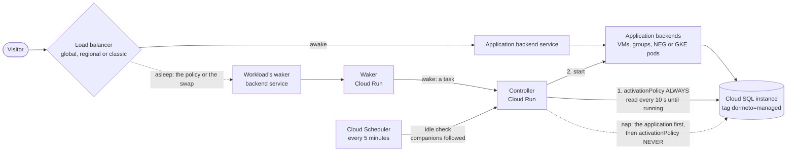

# Google Cloud: Cloud SQL databases

Cloud SQL instances named at a workload's onboarding are its **companions**: they have no route of their own, and nap
and wake with the application's backends (Compute Engine VMs or GKE pods, behind a global, regional or classic load
balancer). The nap stops them after the application, the wake starts them and waits until they run before starting the
application, as [RDS and Aurora databases](databases.md) on AWS. An instance stops and starts by its activation policy;
the router has no connection to it.

**From router 0.37.0, accepted on 2026-11-04** with CLI 0.11.0, with a VM in a zonal NEG: the database
went down after the application and came up before it, a wake after the tag's removal was refused, a database started by
hand while asleep was stopped by the check, and one stopped while awake was started. A stop and a start were measured on
Google beforehand (below), and the tag's condition as the router.

## Services

- **Cloud SQL Admin API** (`sqladmin.googleapis.com`), turned on by `dormeto gcp install --with cloud-sql` (a later run
  with more features adds them; a run without `--with` keeps what is there). It adds two custom roles to the router's
  service account:
  - `dormetoRouterDatabasesRead`: `cloudsql.instances.get` and `cloudsql.instances.list`, on the project: reading an
    instance, its activation policy and its operations. It changes nothing.
  - `dormetoRouterDatabases`: `cloudsql.instances.update`, on the condition that the instance carries the tag
    `dormeto=managed` (`resource.matchTag('<project>/dormeto', 'managed')`). A condition applies to a whole binding,
    hence two roles.
- **Resource Manager tags:** the CLI binds the tag `dormeto=managed` to each instance named at the onboarding, as you
  (`//sqladmin.googleapis.com/projects/<project>/instances/<name>`, at the instance's region's endpoint), and removes the
  binding at the offboarding. The router holds no tag permission. Your own: `cloudsql.instances.get`,
  `.listTagBindings`, `.createTagBinding` and `.deleteTagBinding`, which `dormeto gcp check` lists.
- The services of the application's own scenario ([Compute Engine VMs](google-cloud-compute-engine.md), [Kubernetes on
  GKE](google-kubernetes-engine.md)), and the router itself.

`cloudsql.instances.update` allows every setting of a tagged instance, not only its activation policy: the router changes
only that one, and has no other database permission. The condition holds (measured as the router: a `PATCH` without the
tag was refused (`403`), and accepted 40 s after the tag was bound, at its first try).

What Google adds: turning `sqladmin.googleapis.com` on and creating an instance added nothing to the project's IAM policy
(measured); the instance has its own service account, `p<number>-…@gcp-sa-cloud-sql.iam.gserviceaccount.com`.

## Wake time

**About 9.2 minutes through the router** (551 s, the acceptance, 2026-11-04): from a browser's probe to the application,
for a VM in a zonal NEG with a `db-f1-micro` companion, the database's start, then the VM's. Its nap took 8.5 minutes:
the policy's 300 s, the VM suspended, then the database. Measured once on Google outside the router, the same day, on a
`db-f1-micro` PostgreSQL 16 instance: a start by `activationPolicy: ALWAYS` was done after 562 s, a stop by `NEVER` done
after 104 s. The application's backends start only once the database runs, so their own start comes on top. Larger
instances and other engines were not measured. Visitors see the waiting page meanwhile, which reloads by itself.

The default wake timeout of a workload with a companion is 1700 s, whatever its other backends and its load balancer
(AWS's 1800 s does not fit the controller's request of 1800 s).

## Behavior

**Onboarding.** `dormeto gcp workloads onboard --url-map <m> --backend-service <b> --cloud-sql <instance>`, repeatable:
Dormeto searches no label, you name each instance. The controller's dry run reads each one; the CLI binds the tag, then
the controller onboards the workload. A companion always goes with an application's backends, never alone.

**Nap.**
1. Before anything stops, the nap reads its companions: one deleted (`404`) or that the router can no longer read
   (`403`) gives the nap up (cause `backends-changed`), the application untouched.
2. The application's backends nap ([Compute Engine VMs](google-cloud-compute-engine.md), [Kubernetes on
   GKE](google-kubernetes-engine.md)).
3. Each database gets `PATCH settings.activationPolicy: NEVER`. The nap does not wait for it: Google answers at once with
   an operation, and the policy reads `NEVER` at once (measured).

**Wake.**
1. Each stopped database gets `ALWAYS` first, and the controller reads it every 10 s until it runs: the policy
   `ALWAYS`, the state `RUNNABLE`, and no operation of the instance under way. A database still going down is waited
   for, then started.
2. While another operation runs on the instance, Google answers `409` (`operationInProgress`, measured): the change is
   tried again until the wake's deadline. A start refused for lack of capacity is tried again as on AWS, after 30 s,
   60 s, then every 120 s (no such refusal was met, in the measures or the acceptance: Google's words for it are not
   known).
3. Then the application's backends start, and the wake ends as their scenario says.

**The check (every 5 minutes).** The application's backends decide the workload's state, and the databases follow it:
asleep, a running database is stopped again (`DatabaseRestopped`); awake, a stopped one is started (`DatabaseRestarted`).
One try per check: a refusal, or another operation running, is for the next check. Both were seen in the acceptance;
the start came one check late, after a `409` at the check before.

**Offboarding.** A workload asleep is woken first, its databases with it; the CLI then removes the tag bindings. The
acceptance's took 14 min 44 s, and left the VM and the database running, untagged.

## Limits

- **Keep the 1700 s wake timeout.** It is the most a wake can take. Under a regional or classic load balancer, the map's
  change shares those 1700 s: a database start over about 24 minutes fails the wake after the map changed back, and the
  next check heals it. The measured start took 562 s, and the acceptance's wake 551 s.
- **A primary with read replicas** is taken, with a warning at the onboarding: Google stops only the primary, its
  replicas keep running, and billing, while the workload sleeps (measured: the primary stopped in 32 s, its replica left
  running). **A read replica is refused:** Google refuses `NEVER` on one ("Activation policy for replica must be set to
  ALWAYS"); name its primary, or none.
- **A database belongs to one router, and to one workload.** The onboarding refuses an instance that another workload of
  the router holds. Two routers (two regions) naming one instance would start and stop it in turn at their checks, and
  offboarding one would remove the tag the other needs: name an instance on one router only.
- **Only for databases this workload uses alone.** The router stops a companion with its workload, whoever else uses it.
- **The tag lets the router change it.** If an instance's tag binding is removed, the router's `PATCH` is refused. At a
  nap, the application naps but the database keeps running, and billing: the nap fails at the database (`permission`),
  the next check makes the workload `ASLEEP`, and each check then logs `DatabaseNotFollowed` until the tag is bound again
  (an offboarding and an onboarding bind it). At a wake, the refusal fails the wake, of kind `permission`, the
  application left down: in the acceptance, a wake 5 minutes after the binding's removal was refused (`403`, in the
  router's words naming the tag), and the workload was `ASLEEP` again at the next check. After a new binding, the
  router's first try, 40 s later, was accepted (measured).
- **An offboarding of an awake workload leaves a stopped database stopped.** An offboarding wakes only a workload asleep:
  a database stopped while the workload was awake (by hand, before a check started it again) stays stopped once the
  workload is offboarded. Set its activation policy back to `ALWAYS` yourself.
- **A companion gone.** An instance deleted without an offboarding: each nap reads it first and gives up, the
  application untouched, so the workload no longer naps; a wake starts the application anyway, logged `CompanionGone`, and
  `dormeto gcp workloads show` lists the instance under `companionsGone`, as an application that reports its own
  database error is better than visitors kept out. A plain offboarding goes through: offboard, then onboard again without
  it. Unlike AWS, which finds databases by tag at each nap, the instances are the ones named at the onboarding. How
  Google answers for a deleted instance (a `404`) was not measured, in the measures or the acceptance.
- **Stopped is not free.** Google still bills a stopped instance's storage and IP addresses.
- **The database's readiness is Google's.** The router reads the instance's state, policy and operations, not a
  connection: that an operation's end means the database takes connections was not measured. The application's health
  check decides when the workload is awake.
- **Terraform.** On `google_sql_database_instance`, `lifecycle { ignore_changes = [settings[0].activation_policy] }`: a
  nap sets it to `NEVER`, and an apply would start the database while the workload sleeps (the next check then stops it
  again). The demo's instance has it. The tag's binding is not a field of that resource, so it needs nothing.

## Setup

`dormeto gcp install --with cloud-sql` (with `--image` for the router), then `dormeto gcp workloads onboard … --cloud-sql
<instance>` for each instance; an onboarding with `--cloud-sql` on a router installed without the feature is refused,
with the command that adds it. The CLI's README has the commands.
