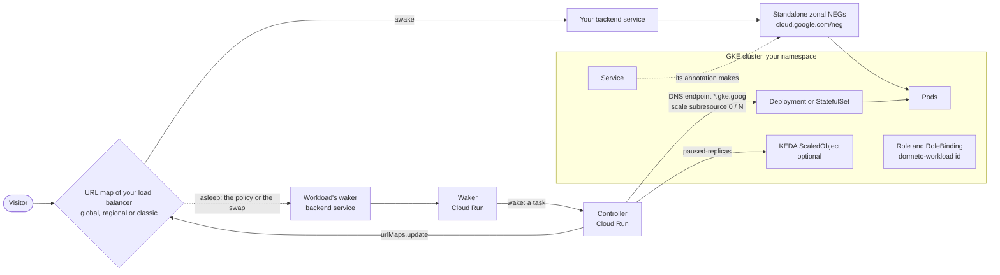

# Google Cloud: Kubernetes on GKE

The pods of one Deployment or StatefulSet of a GKE cluster, behind a **standalone network endpoint group** (the Service's
annotation `cloud.google.com/neg`) that a backend service of your own load balancer names: global, regional or classic.
The nap scales the owner to 0 through its `scale` subresource, the wake gives back its replicas. At 0 replicas the NEG
holds no endpoint, and the load balancer answers its `503`, caught by the custom error response or replaced by the swap,
as for a stopped VM: the switch, the idle check and the wake's wait for health are those of [Compute Engine
VMs](google-cloud-compute-engine.md), and only the backend differs. The router reaches the cluster through its DNS
endpoint, from Cloud Run, with its own access token, and may do there only what a Role in the workload's namespace lets
it.

**From router 0.37.0, accepted on 2026-11-04** with CLI 0.11.0, on a Standard cluster with no KEDA,
behind a global load balancer: onboarded with the Role and RoleBinding the CLI wrote, napped and woken through the
router, the RBAC shown by `access show` and removed at the offboarding, a Gateway's map refused at the dry run, and no
cluster role or binding of Dormeto's in the cluster. The scale to 0 and back, the DNS endpoint, the Role and GKE's own
maps were measured on Google beforehand (below).

## Services

- **Google Kubernetes Engine** (`container.googleapis.com`), turned on by `dormeto gcp install --with gke`, with the
  router's custom role `dormetoRouterKubernetes`: exactly `container.clusters.get` (the cluster's DNS endpoint, and
  whether it is Autopilot) and `container.clusters.connect` (each call through the DNS endpoint). They grant nothing
  inside the cluster.
- **Kubernetes RBAC:** a Role and a RoleBinding in the workload's namespace, which the CLI applies (below).
- **The cluster's DNS endpoint.** `clusters.get` names it (`controlPlaneEndpointsConfig.dnsEndpointConfig.endpoint`, a
  host under `gke.goog` with a public certificate); the router calls it from Cloud Run with its access token, with no VPC
  and no IP endpoint. A cluster with no DNS endpoint open to traffic from outside its network is refused, with the
  command that turns it on (`gcloud container clusters update <name> --location <location> --enable-dns-access`).
- **Your permissions** for the onboarding: those to apply a Role and RoleBinding, including `container.roles.escalate`
  and `container.roles.bind` (Kubernetes lets you grant only what you hold, or with these; Google marks `escalate` as
  testing in custom roles), and, for reading the owner, `container.services.get`, `container.pods.list` and
  `container.replicaSets.list`. `dormeto gcp check --with gke` lists them all.
- The services of the switch ([Compute Engine VMs](google-cloud-compute-engine.md)), and the router itself.

What the router may do in the cluster is a `Role` and a `RoleBinding`, both named `dormeto-<workload>`, in the workload's
namespace, labelled `app.kubernetes.io/managed-by: dormeto`, for the user
`dmtr-<region>@<project>.iam.gserviceaccount.com` (the router's service account). The CLI reads the cluster as you,
prints them, asks, and applies them at the onboarding, and removes them at the offboarding, as it does IAM changes. The
Role's rules are exactly the router's calls:

| API group | Resources | Verbs |
|---|---|---|
| `apps` | `deployments`, `statefulsets` | `get` |
| `apps` | `replicasets` | `list` |
| `apps` | `deployments/scale`, `statefulsets/scale` | `patch` |
| (core) | `pods`, `events` | `list` |
| `keda.sh` | `scaledobjects` | `list`, `patch` |

Nothing cluster-wide: no `ClusterRole`, no `ClusterRoleBinding`, no right outside the namespace, but asking Kubernetes
which rights it holds, as any user may. Before the onboarding, the router can read nothing in the cluster.

Measured as the router (2026-11-04), from Cloud Run, on a Standard cluster: the endpoint `*.<zone>.gke.goog`, with a
public certificate; the router's token accepted; with no Role, a `403` saying the call "requires one of
[container.deployments.getScale container.deployments.get] permission(s) in Cloud IAM or a Kubernetes RBAC role"; with the
CLI's Role (`dormeto gcp workloads access grant`), the Deployment read at once, and the review of its rights listing
exactly the Role's rules. KEDA's rules were taken on a cluster without KEDA's resource definition, and a second `grant`
said "up to date".

What Google adds (measured): turning `container.googleapis.com` on added `roles/container.serviceAgent` and
`roles/file.serviceAgent` to Google's service agents, and turned on the APIs `autoscaling`, `containerfilesystem`, `dns`,
`file`, `gkebackup` and `networkconnectivity`; creating a cluster added `roles/container.defaultNodeServiceAgent` to GKE's
node service agent.

## Wake time

**13 s through the router**, from a browser's probe to the application (the acceptance, 2026-11-04, one run, a Standard
cluster whose node was running); its nap took about 6 minutes, the policy's 300 s, then the scale to 0. Measured once
outside the router the same day: back to 1 replica, the new pod's endpoint was in the NEG at 3 s, the pod running at
4 s, healthy at 5 s, and the application answering steadily 9 s after the scale. Down to 0, the load balancer answered
`503` within 0.5 s, the endpoint read `UNHEALTHY` at 17 s, no status at 41 s, and left at 45 s; the NEG was kept, empty.

When no node has room for the pods, the node autoscaler, or Autopilot, must add one first, which adds its time. The
default wake timeout is 300 s, plus the map's change on a regional or classic load balancer (400 s and 550 s), and
1700 s with a Cloud SQL companion.

## Behavior

**Onboarding.** `dormeto gcp workloads onboard --url-map <m> --backend-service <b> --gke-cluster <location>/<name>`, in
this order:
1. The controller's dry run reads Google only: the load balancer, the backend service's NEGs (each a zonal NEG GKE made,
   all of one Service, which their description names), and the cluster's DNS endpoint. It makes no call to the cluster,
   where the router has no right yet.
2. The CLI reads the cluster as you: the Service's selector, then the owner of its pods. It prints the Role and
   RoleBinding, asks (`--yes` without a terminal), and applies them.
3. The onboarding: the controller asks Kubernetes whether it holds each rule of the Role, reads the owner, checks that the
   NEGs' endpoints are the owner's pods, and writes the workload's configuration.
4. Refused at 3, the CLI removes the Role and RoleBinding it just added.

On a Standard cluster, the onboarding warns that scaling pods saves money only on Autopilot, or with the node autoscaler
freeing a node, as its fixed nodes are paid all the same. `dormeto gcp workloads access show|grant|revoke --gke-cluster
<location>/<name> --namespace <ns> --workload <id>` runs step 2 alone: `show` is read-only and prints what `grant` would
write.

**Nap.**
1. The switch, as for VMs: the custom error response's policy on a global load balancer, the swap and its SWAP_WAIT on a
   regional or classic one.
2. Before it scales anything, the nap reads the backend service's NEGs again, each still of the Service, and their
   endpoints against the owner's pods: endpoints that are not the owner's pods, or no endpoint while the owner has ready
   pods, give the nap up, nothing scaled, the workload awake, said only in the log.
3. The owner's replicas and its KEDA ScaledObject, if any, are recorded on the run.
4. The ScaledObject is paused at 0 (`autoscaling.keda.sh/paused-replicas: "0"`); a pause of your own is recorded and
   given back at the wake.
5. The owner's `scale` subresource is set to 0, and the router waits until its pods are gone.

**Wake.**
1. The owner's `scale` gets back its recorded replicas, at least 1. Replicas set since the nap, by hand or by a GitOps
   tool, are left as they are.
2. The ScaledObject gets back its own pause, or none.
3. The router waits for a healthy endpoint, as for a VM. A pod that stays unschedulable makes the wake `unhealthy` at its
   deadline, with the pods' Kubernetes events. A call to the cluster refused (`403`) is a failure of kind `permission`;
   one with no answer, `timeout`.

**Changes made outside Dormeto.** Replicas set while the workload sleeps make it awake (`external-start`), and the owner
scaled to 0 while it is awake makes it `ASLEEP` (`external-stop`), as VMs started or stopped by hand. GitOps tools must
ignore what Dormeto changes: the owner's `spec.replicas`, and the ScaledObject's `autoscaling.keda.sh/paused-replicas`
annotation.

**Offboarding.** A workload asleep is woken first, KEDA gets its own pause back, the switch and the waker backend service
are removed; the CLI then removes the Role and RoleBinding. It removes only Dormeto's: an object of that name without the
label is refused at the onboarding and left alone.

## Limits

- **Standard clusters save less.** Scaling pods saves money only on Autopilot, or with the node autoscaler freeing a
  node: a Standard cluster's fixed nodes are paid all the same. The onboarding warns of it.
- **Standalone NEGs on a load balancer of your own.** A load balancer GKE owns, from a Gateway or an Ingress (its URL map
  named `k8s2-`, `gkegw1-` or `gkemcg1-`), is refused: GKE writes its map back. Measured: a custom error response policy
  written on a Gateway's map stayed 20 minutes, through an annotation of the HTTPRoute, and GKE took it away, without a
  word, 48 s after the HTTPRoute's rules changed. It lasts until the next change of the Gateway or its routes, which a
  sleeping workload cannot trust. Give the Service a standalone NEG (`cloud.google.com/neg`), name it in a backend
  service of your own load balancer, and onboard that.
- **The DNS endpoint only.** The router reaches a cluster through its DNS endpoint and no other way: no IP endpoint, no
  VPC connector. A private cluster too: turn its DNS endpoint on.
- **Deployments and StatefulSets only, one owner, one Service.** Each backend of the backend service is a zonal NEG of the
  Service's pods, with nothing else beside them: VMs, groups and pods are not mixed in one workload. Pods of no owner, of
  a DaemonSet or a Job, or of several owners are refused by the CLI's reading of the cluster.
- **An owner's pods must be behind the NEG to nap.** If the NEGs hold no endpoint while the owner has ready pods, or hold
  endpoints that are not its pods, every nap gives up, nothing scaled, and only the log says so. If it lasts, offboard and
  onboard again, naming the owner behind the load balancer.
- **A new pod's attach may delay a nap.** A pod just started may not be in the NEG yet (measured: 3 s after the scale), so
  a nap at that moment gives up, and the next idle window asks again.
- **A workload at 0 replicas cannot be onboarded.** The CLI tells the owner from the Service's pods, and with none it
  stops: "no pod behind Service `<service>`: its owner cannot be told (scale it up, then onboard again)".
- **A wake with no record brings 1 replica.** An owner scaled to 0 by hand while the workload is awake becomes `ASLEEP`
  at the next check, with no replicas recorded: its wake gives it 1 replica. Scale it back yourself, or let your
  autoscaler.
- **A KEDA ScaledObject with `minReplicaCount: 0`** already scales the owner to zero by itself, and nothing here refuses
  it yet. When KEDA takes the owner to 0 while the workload is awake, the next check reads it as stopped by hand
  (`external-stop`, the waiting page shown), and a wake brings 1 replica with KEDA not paused, free to scale it down
  again. Keep `minReplicaCount` at 1 or more for a workload Dormeto naps.
- **A forced offboarding leaves an asleep owner at 0.** `dormeto gcp workloads offboard <id> --force`, for a workload
  that cannot wake, leaves the owner at 0 replicas (listed as left) and gives KEDA its own pause back. A pause it cannot
  give back is named under `notGivenBack`, with the annotation to remove or set back (the CLI prints it and exits 1). Scale
  the owner back yourself and fix that annotation, or KEDA takes the owner down again.
- **The RBAC's lag at the onboarding.** If Kubernetes has not applied the new Role when the controller asks (it was
  effective at once when measured), the onboarding is refused, naming the rights it lacks, and the CLI removes the RBAC
  it added: run the same command again.
- **The NEG's cluster is not compared.** A GKE NEG's description names its namespace and Service, and its cluster only by
  the UID of the cluster's `kube-system` namespace, which the router's Role cannot read. The router takes the cluster
  that `--gke-cluster` names: name the right one.
- **Only requests through the load balancer wake the workload.** Calls from inside the cluster to the Service do not,
  and do not keep it awake.
- **Wake timeout.** 300 s by default, plus SWAP_WAIT on a regional or classic load balancer; 1700 s with a Cloud SQL
  companion ([Google Cloud: Cloud SQL databases](google-cloud-sql.md)).
- **Terraform.** On `kubernetes_deployment_v1` or `kubernetes_stateful_set_v1`,
  `lifecycle { ignore_changes = [spec[0].replicas] }`: a nap sets it to 0, and an apply would start the pods while the
  workload sleeps (the next check then makes it awake). The Role and RoleBinding `dormeto-<workload>` are the CLI's: keep
  them out of Terraform.

## Setup

`dormeto gcp install --with gke` (with `--image` for the router), then `dormeto gcp workloads onboard … --gke-cluster
<location>/<name>`; an onboarding with `--gke-cluster` on a router installed without the feature is refused, with the
command that adds it. A GKE-only workload binds no tag. The CLI's README has the commands.
