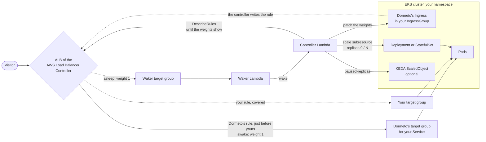

# Kubernetes on EKS

The pods of one Deployment or StatefulSet of an Amazon EKS cluster, behind an Application Load Balancer of the AWS Load
Balancer Controller: the nap scales the owner to 0 through its `scale` subresource once its pods are drained, the wake
gives back its replicas. Kubernetes workloads are onboarded from the manager.

The diagram shows the `ingress` switch. The router calls the cluster's API over HTTPS from outside any VPC, with an EKS
token signed by its role.

## How the waker is switched in

The AWS Load Balancer Controller deletes listener rules it does not own, so the switch lives in the Kubernetes or AWS
objects it reads. The onboarding picks the mode from how your Service is exposed.

| Your setup | Switch | What Dormeto changes | Your objects |
|---|---|---|---|
| A TargetGroupBinding to a load balancer you own | `rule` | Your listener rules, as for any workload: shadow rules with weights | Untouched in the cluster |
| An Ingress in an IngressGroup (`group.name`) | `ingress` | Adds its Ingress `dormeto-<workload id>` to the group, ranked just before yours (`group.order`), with your rule's host, paths, conditions, `listen-ports` and target group annotations, forwarding by `actions.dormeto` to your Service and to the waker | Never changed |
| An Ingress outside any group | `patched-ingress` | Patches your Ingress: the paths leading to the Service use `actions.dormeto`. Offboarding restores it exactly | Patched |

In the `ingress` mode, the controller gives Dormeto's Ingress its own target group for your Service. While Dormeto's
rule is there, that target group takes the workload's requests: the idle check counts both target groups, and the wake
waits for a healthy target in Dormeto's.

After each switch, the router reads the load balancer's rule every 2 s until it shows the weights, at most 120 s (the
controller takes about 2 s, the load balancer about 11 s more).

## Services

- **Amazon EKS:** `eks:DescribeCluster` (the endpoint and its certificate authority), and access entries for the
  router's roles in the Kubernetes group `dormeto:router`.
- **The Kubernetes API:** the owner's `scale` subresource, pods, events, Ingresses, KEDA ScaledObjects.
- **AWS Load Balancer Controller:** writes the rules and target groups from the Ingresses.
- **Elastic Load Balancing:** reading the rules and the target groups' health, and the rules themselves in `rule` mode.
- **AWS Lambda, DynamoDB, EventBridge Scheduler, CloudWatch:** the router itself.

The group `dormeto:router` gets the rights of [`kubernetes/dormeto-router.yaml`](../../kubernetes/dormeto-router.yaml),
and nothing else (no Secrets):
- read Deployments, StatefulSets, ReplicaSets, Pods, Services, Events, Ingresses, HorizontalPodAutoscalers and KEDA
  ScaledObjects, and get Nodes;
- get and patch the `scale` subresource of Deployments and StatefulSets;
- patch ScaledObjects;
- create, patch and delete Ingresses.

A ValidatingAdmissionPolicy (Kubernetes 1.30 or later) lets the group create and delete only the Ingresses labelled
`dormeto.com/managed`, and never add or remove that label. The manager makes the access entries when it installs the
router, or the [`eks-access`](../../terraform/modules/eks-access) Terraform module does. The controller's `clusterCheck`
action names any right that is missing, and the onboarding refuses a workload until nothing is.

## Wake time

- **22–26 s measured with pods on EC2 nodes** (9 wakes across a Deployment, a StatefulSet, a Deployment with an HPA, a
  lone Ingress and a TargetGroupBinding).
- **62–74 s measured with pods on Fargate** (2 wakes).

The test pods request 100m CPU and 128 MiB, and their health checks use the AWS Load Balancer Controller's defaults
(every 15 s, 2 healthy checks). Fargate provisions a node for each pod, hence the longer time. When no node has room for
the pods, Karpenter or the Cluster Autoscaler must launch one first, which adds the node's launch and join time. The
wake timeout's 300 s default leaves room for it.

## Behavior

**Nap.**
1. The waker is switched in (above), and the router waits until the load balancer shows it. If the switch does not show
   within 120 s, the nap is cancelled and the workload stays awake (cause `switch-failed`).
2. The drain (30 s). A request now cancels the nap.
3. A KEDA ScaledObject targeting the owner is paused at 0 (`autoscaling.keda.sh/paused-replicas: "0"`). A pause of your
   own is recorded and given back at the wake.
4. The owner's `scale` subresource is set to 0 replicas. An HPA needs nothing: it leaves a target at 0 replicas alone.
5. The router waits until the owner has no pod left, terminating ones included (every 3 s, at most 5 minutes), then up
   to 2 minutes for the target group to release them.

A nap took 34–37 s.

**Wake.**
1. The owner's `scale` subresource gets back its recorded replicas, at least 1.
2. A KEDA ScaledObject gets back its own pause, or none.
3. Every 30 s, the router reads the pods' Warning events:
   - `FailedScheduling` is a `capacity` failure, waited out until the wake timeout, since a node may come;
   - image pull errors and crash loops are `configuration` failures and end the wake at once.
4. A call to the cluster that fails (the scale, a patch) ends the wake and says why: a 401 or 403 is `permission`, a
   429 `throttled`, an unreachable cluster or a 5xx `cluster`.
5. At the first healthy target, the waker is switched out, and the router waits again until the load balancer shows it.

**GitOps and drift.** Kubernetes changes do not reach CloudTrail, so the 5-minute check looks for them:
- replicas set while the workload sleeps (a GitOps tool resetting them) make the workload awake, recorded as a drift,
  not a visitor's wake;
- Dormeto's Ingress changed or deleted, or the patch of a lone Ingress reverted, is applied again and recorded as a
  drift.

GitOps tools must ignore what Dormeto changes: the owner's `spec.replicas`, the ScaledObject's
`autoscaling.keda.sh/paused-replicas` annotation and, for a patched Ingress, its `alb.ingress.kubernetes.io/actions.dormeto`
annotation and the patched paths' backends. The onboarding dialog gives the snippet.

## Limits

- **EKS only, with a public endpoint open to every address.** The router's Lambdas run outside any VPC. A private
  cluster or an endpoint restricted to some addresses is not supported yet: it waits for an in-cluster agent.
- **Access entries.** A cluster in `CONFIG_MAP` mode (aws-auth only) needs the router's roles mapped to the group
  `dormeto:router` by hand, or a switch to `API_AND_CONFIG_MAP`.
- **Kubernetes 1.30 or later** for the admission policy. On older clusters the group's Ingress rights are not narrowed.
- **AWS Load Balancer Controller and an ALB.** Network Load Balancers and Services of type `LoadBalancer` are not
  supported.
- **Deployments and StatefulSets only.** DaemonSets, Jobs, bare pods and Argo Rollouts are refused.
- **One owner per target group.** If the target group holds pods of another owner (a canary with the same labels), the
  workload is ignored.
- **ip targets.** Tested with pods registered as ip targets (`target-type: ip`). Instance targets are untested.
- **One rule of your Ingress per workload.** Dormeto copies one rule (host) and its paths that lead to the Service. Any
  other listener rule forwarding to the same target group is an issue and blocks naps.
- **Group-wide annotations are not copied** (certificates, scheme, SSL redirect): they already apply to the whole
  IngressGroup.
- **Only requests through the load balancer wake the workload.** Calls from inside the cluster to the Service do not.
- **Wake timeout.** 300 s by default, 1800 s with a database companion.
