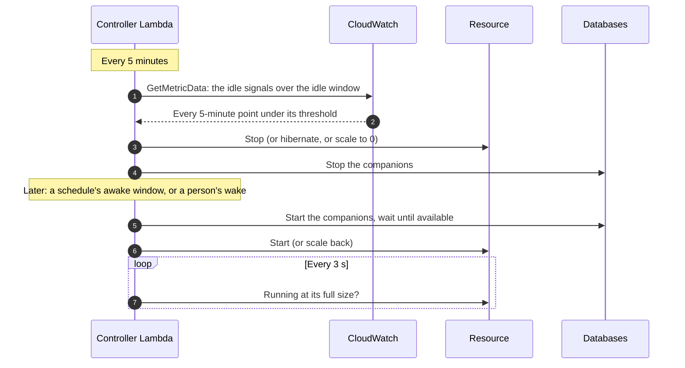

# Standalone workloads

Not released yet: router 0.42.0.

A **standalone workload** is one stoppable resource that no load balancer serves: a batch server, a build agent, a worker
service, a database used by hand. The router naps it when its idle signals show nothing happening for its idle window, on a
schedule or on a person's word, and wakes it on a schedule or on a person's word. **Nothing wakes it on demand**: there is no
request to see, so there is no waiting page, no wake rule, no wake mode and no held request.

It is the same on AWS and on Google Cloud: the same settings, levels, idle rule, schedules and states. What differs is said once
below: the resources, the metrics read, the custom metric's shape, what marks a resource as the workload's, and the limits.

On AWS:



On Google Cloud, the same steps through a Cloud Tasks task:

```mermaid
sequenceDiagram
  autonumber
  participant G as Controller (Cloud Run)
  participant CM as Cloud Monitoring
  participant R as VM, group or Cloud SQL instance
  participant D as Cloud SQL companions
  Note over G: Every 5 minutes, Cloud Scheduler's check
  G->>R: Read its state (a group: its VMs listed)
  G->>CM: timeSeries.list: each signal's metric type over the idle window
  CM-->>G: Every 5-minute point under its threshold
  Note over G: The nap, a task of its own
  G->>R: Stop or suspend (a group: its VMs in place, its autoscaler off; Cloud SQL: activation NEVER)
  G->>D: Activation NEVER
  Note over G: Later: a schedule's awake window, or a person's wake
  G->>D: Activation ALWAYS, wait until runnable
  G->>R: Start or resume (Cloud SQL: ALWAYS)
  loop Until the wake timeout
    G->>R: Running at its full size?
  end
```

## What can be standalone

| Resource | Nap | Wake |
|---|---|---|
| EC2 instance outside an Auto Scaling group | Stopped, or hibernated when it was launched with hibernation | Started |
| Auto Scaling group | Scaled to 0, its scaling processes suspended | Given back its size, processes resumed |
| ECS service | Desired count 0, its Application Auto Scaling target suspended | Its desired count back |
| RDS instance or Aurora cluster | Stopped | Started, then waited until available |
| Google Cloud: Compute Engine VM outside a managed instance group | Stopped, or suspended when it can be | Started, or resumed |
| Google Cloud: managed instance group | Its VMs stopped or suspended in place, its autoscaler off | Its VMs started, its autoscaler's mode back |
| Google Cloud: Cloud SQL instance | Its activation policy `NEVER` | `ALWAYS`, then waited until runnable |

On AWS, the onboarding refuses a resource that cannot be one, with a reason:

- **It belongs to an HTTP workload:** an instance that is a target of a target group, an Auto Scaling group attached to a
  target group, or an ECS service registered with one. Onboard its target group instead.
- **It is in another workload:** it carries another workload's `dormeto:workload` tag, it is a companion database of
  another workload, or it is onboarded already. A resource is in one workload; an HTTP onboarding also refuses a target
  group whose backend, or a database, is a standalone workload's, naming it: offboard that one first.
- **An instance** that is not found or terminated, that is in an Auto Scaling group (onboard the group: it would replace a
  stopped instance), whose root volume is an instance store (it cannot be stopped), or that is a **Spot instance**: Dormeto
  stops On-Demand instances only.
- **An Auto Scaling group** that holds EKS nodes (its tags say so: EKS, eksctl, Karpenter or the cluster autoscaler): onboard
  the Kubernetes workloads that run on them.
- **An ECS service** with the daemon scheduling strategy: it has no desired count to set to 0.
- **An RDS instance** that is a member of an Aurora cluster (onboard the cluster) or a read replica, and **an Aurora
  Serverless v1 cluster**: RDS cannot stop them.

A resource behind a Classic Load Balancer, which uses no target group, is not told apart: the router refuses what feeds a
target group only, so an instance, an Auto Scaling group or an ECS service behind a Classic Load Balancer can be onboarded as a
standalone workload, and its schedule or its idle signals would stop it. Onboard only what no load balancer serves.

On Google Cloud, the onboarding refuses (the router's own words):

- **It is in another workload:** a backend of an onboarded workload, another standalone workload's resource or companion, or
  a resource onboarded already. The HTTP onboarding refuses a backend service whose VM, group or database is a standalone
  workload's, naming it.
- **A VM** not found, that is a member of a managed instance group (onboard the group: it would repair a stopped VM), that
  is a GKE node (its `goog-gke-node` label), or that has a GPU or a local SSD.
- **A managed instance group** not found, with a stateful configuration, regional with the target shape `EVEN` and
  instance redistribution on, or that holds GKE nodes. A group sized 0 is accepted: it is awake with no VM.
- **Spot and preemptible VMs** are accepted on Google Cloud, a VM or a group's.
- **A Cloud SQL instance** not found, or a read replica; on a router installed without `--with cloud-sql`, it cannot be read.
- **A resource of another project:** a router serves its own project.
- **Whether a VM or a group backs a backend service** the router cannot tell (its role lists no backend service): the
  manager's scan offers only what no backend service uses.
- **The manager's scan lists a project's Cloud SQL instances** (Not released yet: router 0.42.0): its discovery role,
  `dormetoDiscovery`, reads them with `cloudsql.instances.get` and `cloudsql.instances.list`, and offers none that is a
  read replica. In a project where the Cloud SQL Admin API is off (only a router installed with `--with cloud-sql` turns
  it on), Google refuses the read and the scan says Cloud SQL was not read; nothing turns the API on for it.
- **The manager's scan reads target pools and target instances** (Not released yet: router 0.42.0):
  `compute.targetPools.list` and `compute.targetInstances.list` (their aggregated lists take the same permissions), with
  `dormetoDiscovery`. A VM that a target-pool Network Load Balancer or a target instance (protocol forwarding) uses has no
  backend service, and it is never offered as a standalone workload.
- **The CLI checks that a VM or a group serves no load balancer** (Not released yet: router 0.42.0) before it onboards it,
  with the operator's own rights: `compute.backendServices.list`, `compute.regionBackendServices.list`,
  `compute.targetPools.list`, `compute.targetInstances.list`, `compute.instanceGroups.list`,
  `compute.networkEndpointGroups.list` and `compute.instanceGroupManagers.get`, the onboarding step `resourceCheck` of
  `gcp/access.json`, needed to onboard a standalone resource only. Without them the CLI stops and names the listings it could
  not make, unless `--unchecked` is given.

A standalone workload may name **companion databases**, as an HTTP workload's: they stop after it and start before it. A
database alone is a standalone workload whose resource is the database.

## Idle signals

A standalone workload is idle when **every signal it has is under its threshold at every 5-minute point of its idle
window**, and it has been awake for the whole window. A missing point, or a read that fails, is never idle. With no signal
at all, it never naps on idle: schedules and people only.

| Setting | Values | Built-in | Signal |
|---|---|---|---|
| `idleMinutes` | 5 to 1440 | 120 (an HTTP workload's: 15) | The idle window |
| `idleCpuPercent` | 0 to 100, or `off` | 5; `off` when the resource is a database | The CPU's maximum: `AWS/EC2 CPUUtilization` by instance or by group, `AWS/ECS CPUUtilization` by cluster and service, `AWS/RDS CPUUtilization` |
| `idleNetworkBytes` | 0 to 10,000,000,000, or `off` | `off` | The bytes in and out, a minute: `AWS/EC2 NetworkIn` + `NetworkOut`, `AWS/RDS NetworkReceiveThroughput` + `NetworkTransmitThroughput`. An ECS service has none without Container Insights: the signal does not apply there, and the status says so |
| `idleMetric` | `{ namespace, name, dimensions, statistic, below }`, or `off` | `off`; the type `databases`: its database's `AWS/RDS DatabaseConnections`, `Maximum`, below 1 | One CloudWatch metric of your own; `statistic` is `Maximum`, `Average` or `Sum`; a dimension's value may hold `${resource}`, replaced by the resource's own id (instance id, group name, service name, database identifier) |

- **Levels.** These settings resolve as every other: the workload's own, its type's, the router's, the organization's,
  then the built-in value. `off` at a level turns off a signal a level above sets. The status says each threshold's level.
- **On Google Cloud** the same settings read Cloud Monitoring, 5-minute aligned points with the same 10-minute lag: CPU
  `compute.googleapis.com/instance/cpu/utilization` for a VM and each VM of a group (a ratio, its threshold still a
  percentage), `cloudsql.googleapis.com/database/cpu/utilization` for a Cloud SQL instance; the network
  `compute.googleapis.com/instance/network/received_bytes_count` + `sent_bytes_count`, bytes a minute; a Cloud SQL
  instance's network is not read, its connections are its signal. `idleMetric` there is `{ type, filter, aligner, below }`:
  a Cloud Monitoring metric type, an optional filter in which `${resource}` is the resource's name, the aligner `ALIGN_MAX`,
  `ALIGN_MEAN` or `ALIGN_SUM`, and the threshold. The type `databases`' connections are
  `cloudsql.googleapis.com/database/network/connections`, `ALIGN_MAX`, below 1. A level holds one metric: a custom metric for
  both clouds takes one type a cloud, as each router ignores the other cloud's shape in the organization's settings. The wake
  timeout is 1700 s at most on Google Cloud, a controller request's limit.
- **The type `databases`.** A workload with a database, as its resource or as a companion, has its connections under 1
  as a signal, read for each companion its configuration lists (`databases` at onboarding or in the `workload` module): each
  must be under 1. A companion found by its tag alone is napped and woken with the workload but not read. A server with a
  companion database keeps its CPU signal too: all must be idle.
- **The 10-minute lag.** CloudWatch publishes a point minutes after its period ends, so the window the router reads ends
  10 minutes behind, at a 5-minute boundary. An idle nap therefore comes 10 to 15 minutes after the idle window, on the next
  5-minute check. A busy workload is read again once its window can be idle; a missing last point, at the next check. A
  queued idle nap delivered more than a minute after it was asked reads the signals again and is skipped if the workload is
  busy; a person's nap is never read against the signals.
- **The status** shows each signal: its threshold, its level, its last value, since when it is under, and the nap
  estimate from them.
- **What a read calls.** On AWS, one GetMetricData call for all its signals, a group's by its name. On Google Cloud, one
  timeSeries.list call a metric type, a managed instance group's VMs listed first (listManagedInstances), and each check
  reads the resource's state first (a Cloud SQL instance: its settings and its operations under way). The check reads the
  signals only once the workload can be idle. The status reads them live, at each status asked.
- An HTTP workload keeps its one signal, its requests: these settings are refused on it.

## Schedules, people and changes made outside Dormeto

- **Schedules** work as for an HTTP workload: a nap window naps it; an awake window wakes it, and keeps it from an idle
  nap while it lasts and in the 30 minutes before it starts. A nap window has no `wake` choice: nothing arrives to wake it
  then, so the field is refused.
- **After an idle nap it stays asleep** until a schedule's awake window, a person's wake (the manager, the CLI, the API)
  or a start made outside Dormeto. A workload with a schedule is the expected case.
- **Pauses and hibernation** work as for an HTTP workload.
- **Awake** once every backend runs: an instance running, a group at its size with its instances in service, a service
  at its desired count with its tasks running, a database available, within the wake timeout (600 s, 1800 s for the type
  `databases`).
- **A failed wake** stays failed and is retried by the check after 60 s, doubled after each failure in a row, at most 30
  minutes, until a wake succeeds, everything stopped or not: nothing wakes the workload on demand, so a failure for want of
  capacity must not lose its awake window. A keepAsleep pause or a nap window holds the retry; a person's nap ends it (its
  backends stop and the workload is asleep). A person's nap asked stops the retry at once, before its release runs; a
  release that fails is recorded as a nap's failure, tried again once an idle window, never followed by a wake. A release
  is journaled as the person's nap (cause `manager`, with `by`); the check's own release of a failed nap after its idle
  window, as `failed-released`. Once asleep the failure goes. The row's and the status's `nextAttemptAt` is the retry's time
  only while one is coming: none while a pause or a nap window holds it, its settings levels or its resource cannot be read,
  its resource is missing, or a person's nap is asked. Only a person's nap releases a failed workload: an idle or a
  schedule's nap of it is skipped.
- **A failure for a permission** (the role's condition on the resource: on AWS its `dormeto:workload` tag, on Google Cloud
  the tag `dormeto=managed`, which the failure names) stays on the workload at every check, never read as recovered, until a
  nap or a wake succeeds, so its status and the manager's alerts show it.
- **A start or stop made outside Dormeto** (the console, a script, AWS's own restart of a database stopped 7 days) is seen
  at the next check: the workload is awake (`external-start`, its stopped companions started) or asleep (`external-stop`).
- **A Cloud SQL resource the router may not read** (a router installed without `--with cloud-sql`): read at each check,
  refused, the workload is neither napped, nor woken, nor retried, and the router's health warns `cloud-sql-unreadable`
  with the count of such workloads, in the check's summary and in the router's answer.
- **On Google Cloud** what marks a resource as the workload's is its record alone: the router's roles act only on what has the
  tag `dormeto=managed`, which the CLI binds, but the router cannot read it, so a resource is missing when Google says it
  is deleted.
- **A resource deleted, or its `dormeto:workload` tag removed:** the workload has no backend, nothing is stopped or
  started (its databases included), its state stays, and the router's health warns. Tag it again to keep the workload,
  or offboard it: such a workload is offboarded whatever its state (it cannot be woken), its databases untagged, what is gone
  skipped.

## Onboarding

- **The manager** calls the onboarder's `preview` and `onboard` with `resourceArn` in place of `targetGroupArn`. The
  onboarding tags the resource and its companion databases `dormeto:workload` (with the marker `dormeto:tagged = onboarder`)
  and writes the workload's configuration: no waker target group, no rule. Offboarding removes the tags and the
  configuration; it needs the workload awake, unless its resource is gone (deleted, or its tag removed), when it is
  offboarded in any state and its step says what it skipped.
- **Terraform:** the `workload` module takes `resource_arn` in place of `app_target_group_arn` (one of the two), the
  settings `idle_minutes`, `wake_timeout_seconds`, `idle_cpu_percent`, `idle_network_bytes`, `idle_metric`, `hibernate`,
  `type`, `fallback_instance_types` and `databases`; the waker's settings are refused with it. Tag the resource and its
  databases `dormeto:workload = <workload_id>` yourself.
- **Google Cloud:** the router's `POST /v1/workloads` (the CLI's) and the manager's `preview` and `onboard` actions take
  `resource` (the resource's path) in place of `urlMap` and `backendService`, and `cloudSql` or `databases` for its
  companions. The router writes the workload's record only: the CLI binds the tag `dormeto=managed` on the resource and its
  companions, as for an HTTP workload's backends, and unbinds it at the offboarding. No waker backend service, no URL map
  change.
- **Permissions:** none new. The router's mutations are conditioned on the workload tag, and it already reads CloudWatch,
  EC2, Auto Scaling, ECS and RDS; on Google Cloud, its roles already read Compute Engine, Cloud SQL (with `--with cloud-sql`)
  and Cloud Monitoring.

## Limits

- **Nothing wakes it on demand:** no connection, request or message wakes a standalone workload, nor keeps it awake.
- **One custom metric** a workload.
- **Spot instances** are refused on AWS; Google Cloud accepts Spot and preemptible VMs (a preempted VM is stopped by Google,
  which the next check reads as a stop made outside Dormeto).
- **Google Cloud:** the router cannot tell a VM or a group behind a backend service it does not know; the wake timeout is
  1700 s at most; a Cloud SQL instance's network is not a signal. Two onboardings of one resource under two ids at the same
  moment are not serialised: both may pass the check that the resource is in no workload, as for an HTTP workload's
  backends.
- **Timing.** Naps start on the 5-minute check, 10 to 15 minutes after the idle window.
